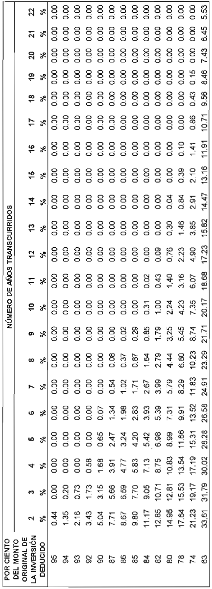
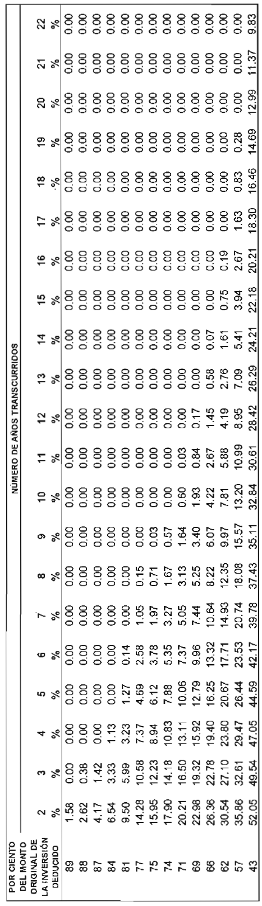

# Transitorios de Ley del Impuesto sobre la Renta (LISR)

> Texto tal cual del PDF de la Cámara de Diputados: transitorios del decreto original y de los decretos de reforma. Muchos transitorios ya agotaron sus efectos; verificar siempre su vigencia.

## Transitorios y disposiciones del decreto original

DISPOSICIONES DE VIGENCIA TEMPORAL DE LA LEY DEL IMPUESTO SOBRE LA RENTA

ARTÍCULO OCTAVO. Para los efectos de lo dispuesto en la fracción I, inciso a), numeral 2 del artículo 166 de la Ley del Impuesto sobre la Renta, durante el ejercicio fiscal de 2014, los intereses a que hace referencia dicha disposición podrán estar sujetos a una tasa del 4.9 por ciento, siempre que el beneficiario efectivo de esos intereses sea residente de un país con el que se encuentre en vigor un tratado para evitar la doble tributación celebrado con México y se cumplan los requisitos previstos en dicho tratado para aplicar las tasas que en el mismo se prevean para este tipo de intereses.

DISPOSICIONES TRANSITORIAS DE LA LEY DEL IMPUESTO SOBRE LA RENTA

ARTÍCULO NOVENO. En relación con la Ley del Impuesto sobre la Renta a que se refiere el Artículo Séptimo de este Decreto, se estará a lo siguiente:

I. La Ley del Impuesto sobre la Renta a que se refiere el Artículo Primero del presente Decreto entrará en vigor el 1 de enero de 2014, salvo que en otros artículos del mismo se establezcan fechas de entrada en vigor diferentes.

II. Se abroga la Ley del Impuesto sobre la Renta publicada en el Diario Oficial de la Federación el 1 de enero de 2002. El Reglamento de la Ley del Impuesto sobre la Renta de fecha 17 de octubre de 2003 continuará aplicándose en lo que no se oponga a la presente Ley del Impuesto sobre la Renta y hasta en tanto se expida un nuevo Reglamento.

Las obligaciones y derechos derivados de la Ley del Impuesto sobre la Renta que se abroga conforme a esta fracción, que hubieran nacido durante su vigencia, por la realización de las situaciones jurídicas o de hecho previstas en dicha Ley, deberán ser cumplidas en las formas y plazos establecidos en el citado ordenamiento y conforme a las disposiciones, resoluciones a consultas, interpretaciones, autorizaciones o permisos de carácter general o que se hubieran otorgado a título particular, conforme a la Ley que se abroga.

III. Cuando en la Ley del Impuesto sobre la Renta se haga referencia a situaciones jurídicas o de hecho, relativas a ejercicios anteriores, se entenderán incluidos, cuando así proceda, aquéllos que se verificaron durante la vigencia de la Ley del Impuesto sobre la Renta que se abroga.

IV. A partir de la fecha en que entre en vigor la Ley del Impuesto sobre la Renta, quedan sin efectos las disposiciones legales, reglamentarias, administrativas, resoluciones, consultas, interpretaciones, autorizaciones o permisos de carácter general o que se hubieran otorgado a título particular, que contravengan o se opongan a lo preceptuado en esta Ley.

V. Los contribuyentes que con anterioridad a la entrada en vigor de la Ley del Impuesto sobre la Renta, hubiesen efectuado inversiones en los términos del artículo 38 de la Ley del Impuesto sobre la Renta que se abroga, que no hubiesen sido deducidas en su totalidad con anterioridad a la fecha de entrada en vigor de esta Ley, aplicarán la deducción de dichas inversiones conforme a la Sección II del Capítulo I del Título II de la Ley del Impuesto sobre la Renta, únicamente sobre el saldo que conforme a la Ley del Impuesto sobre la Renta que se abroga se encuentre pendiente por deducir, y considerando como monto original de la inversión el que correspondió en los términos de esta última Ley.

VI. Los contribuyentes que con anterioridad a la entrada en vigor de la Ley del Impuesto sobre la Renta, hubiesen sufrido pérdidas fiscales en los términos del Capítulo V del Título II de la Ley del Impuesto sobre la Renta que se abroga, que no hubiesen sido disminuidas en su totalidad a la fecha de entrada en vigor de esta Ley, disminuirán dichas pérdidas en los términos del Capítulo V del Título II de la Ley del Impuesto sobre la Renta, considerando únicamente el saldo de dicha pérdida pendiente de disminuir, conforme a la Ley del Impuesto sobre la Renta que se abroga, se encuentre pendiente de disminuir.

VII. Hasta en tanto entren en vigor nuevos Convenios de Colaboración Administrativa en Materia Fiscal Federal, continuarán vigentes las facultades delegadas en materia del impuesto sobre la renta contenidas en los Convenios de Colaboración Administrativa en Materia Fiscal Federal celebrados por el Gobierno Federal por conducto de la Secretaría de Hacienda y Crédito Público con las entidades federativas en vigor y anexos correspondientes, así como sus respectivos acuerdos modificatorios.

El ejercicio de las facultades delegadas en materia del impuesto sobre la renta, conforme a los convenios vigentes a que se refiere el párrafo anterior, se entenderá referido a la Ley del Impuesto sobre la Renta a partir de la fecha de su entrada en vigor.

Los asuntos en materia del impuesto sobre la renta que a la fecha de entrada en vigor de la presente Ley se encuentren en trámite ante las autoridades fiscales de las entidades federativas, serán concluidos por éstas, en los términos de la Ley del Impuesto sobre la Renta que se abroga.

VIII. Las entidades federativas mantendrán vigentes las facultades de comprobación a las que hace referencia el Código Fiscal de la Federación y la Ley del Impuesto Sobre la Renta que se abroga, por lo que hace a las obligaciones fiscales de los contribuyentes correspondientes al ejercicio fiscal de 2013 y anteriores.

IX. Los contribuyentes obligados a presentar declaraciones informativas en los términos de la Ley del Impuesto sobre la Renta que se abroga, deberán presentar las declaraciones correspondientes al ejercicio que concluye el 31 de diciembre de 2013, a más tardar el 15 de febrero de 2014.

X. Para los efectos de la obligación de presentar las declaraciones informativas y constancias establecidas en los artículos 86, fracciones III, IV, VIII, IX, X, XIV, 101, VI, 118, III, V, 143, último párrafo, 144 y 164 de la Ley del Impuesto sobre la Renta que se abroga, se deberá cumplir con dicha obligación en los términos de esa Ley, a partir del 1 de enero de 2014 y hasta el 31 de diciembre de 2016.

XI. Los contribuyentes que hubieran optado por considerar como ingreso obtenido en el ejercicio, la parte del precio efectivamente cobrado en una enajenación a plazo en términos del artículo 18, fracción III de la Ley del Impuesto sobre la Renta que se abroga, que aún tengan cantidades pendientes de acumular a la entrada en vigor de este Decreto, respecto de las enajenaciones a plazo celebradas hasta el 31 de diciembre de 2013, estarán a lo siguiente:

a) Aplicarán lo dispuesto en la Ley del Impuesto sobre la Renta que se abroga, hasta en tanto acumulen la cantidad pendiente de cobro del total del precio pactado en la enajenación, respecto de la totalidad de las enajenaciones a plazo.

El impuesto que resulte conforme al régimen contenido en el segundo párrafo de la fracción III del artículo 18 de la Ley del Impuesto sobre la Renta que se abroga, se podrá enterar en dos partes iguales, el 50% en el ejercicio en el que se acumule el ingreso y el 50% restante en el siguiente ejercicio.

El impuesto que podrá diferirse conforme al párrafo anterior, será el que corresponda a la proporción que representen las enajenaciones a plazo, respecto a la totalidad de las operaciones que realice el contribuyente en el periodo de que se trate. El impuesto que se difiera conforme a este inciso, se actualizará desde el mes por el que se tomó la opción, y hasta por el mes en el que se pague el mismo.

b) Cuando el contribuyente enajene los documentos pendientes de cobro o los dé en pago, deberá considerar la cantidad pendiente de acumular como ingreso obtenido en el ejercicio en el que realice la enajenación o la dación en pago, en términos de la Ley del Impuesto sobre la Renta que se abroga.

c) En el caso de incumplimiento de los contratos de enajenaciones a plazo, el enajenante considerará como ingreso obtenido en el ejercicio, las cantidades cobradas en el mismo del comprador, disminuidas por las cantidades que ya hubiera devuelto conforme al contrato respectivo, en términos de la Ley del Impuesto sobre la Renta que se abroga.

XII. Los contribuyentes que hubieran optado por acumular sus inventarios, para determinar el costo de lo vendido, deberán seguir aplicando lo establecido en las fracciones IV, V, VI, VII, IX y XI del Artículo Tercero de las Disposiciones Transitorias de la Ley del Impuesto sobre la Renta del Decreto por el que se reforman, adicionan, derogan y establecen diversas disposiciones de la Ley del Impuesto sobre la Renta y de la Ley del Impuesto al Activo y establece los Subsidios para el Empleo y para la Nivelación del Ingreso, publicado en el Diario Oficial de la Federación el 1 de diciembre de 2004.

XIII. Las sociedades de inversión de capitales que al 31 de diciembre de 2013, hubieren ejercido la opción prevista en el artículo 50 de la Ley del Impuesto sobre la Renta que se abroga, y únicamente respecto de las inversiones en sociedades promovidas que hubieran realizado hasta dicha fecha, deberán acumular las ganancias por enajenación de acciones, intereses y del ajuste anual por inflación, hasta el ejercicio fiscal en el que distribuyan dividendos a sus accionistas.

Para efectos del párrafo anterior, las sociedades de inversión de capitales actualizarán las ganancias por enajenación de acciones y los intereses, desde el mes en el que los obtengan y hasta el mes en el que los distribuyan a sus integrantes. Las sociedades que ejercieron las opciones mencionadas deducirán el ajuste anual por inflación deducible, los intereses actualizados, así como las pérdidas actualizadas por enajenación de acciones, en el ejercicio en el que distribuyan la ganancia o los intereses señalados. Los intereses deducibles y la pérdida por enajenación de acciones se actualizarán por el periodo comprendido desde el mes en el que los intereses se hubieren devengado o la pérdida hubiere ocurrido y hasta el último mes del ejercicio en el que se deducirán.

Cuando las sociedades de inversión de capitales que hayan optado por acumular el ingreso en los términos señalados en el párrafo anterior, distribuyan dividendos, deberán estar a lo señalado en el artículo 10 de la Ley del Impuesto sobre la Renta.

En los casos a que se refiere el párrafo anterior, la sociedad de inversión de que se trate deberá disminuir de la utilidad fiscal neta que se determine en los términos del tercer párrafo del artículo 77 de la Ley del Impuesto sobre la Renta, correspondiente al ejercicio en que se efectuó la distribución referida, el monto de los dividendos distribuidos en los términos de esta fracción.

Lo dispuesto en esta fracción sólo será aplicable a las inversiones en acciones de sociedades promovidas que se hubieran realizado hasta el 31 de diciembre de 2013.

Las sociedades de inversión de capitales por las ganancias por enajenación de acciones, intereses y el ajuste anual por inflación, respecto de inversiones en sociedades promovidas realizadas a partir del 1 de enero de 2014, para su acumulación, estarán a lo dispuesto en la Ley del Impuesto sobre la Renta.

XIV. A partir del 1 de enero de 2014, las instituciones de crédito no podrán deducir las pérdidas por créditos incobrables, que provengan de la creación o incremento de las reservas preventivas globales que hayan sido deducidas conforme al artículo 53 de la Ley del Impuesto sobre la Renta que se abroga.

Cuando el saldo acumulado de las reservas preventivas globales por las que se ejerció la opción prevista en el artículo 53 de la Ley del Impuesto sobre la Renta que se abroga, que de conformidad con las disposiciones fiscales o las que establezca la Comisión Nacional Bancaria y de Valores, tengan las instituciones de crédito al 31 de diciembre del ejercicio de que se trate, sea menor que el saldo acumulado actualizado de las citadas reservas que se hubiera tenido al 31 de diciembre del ejercicio inmediato anterior, la diferencia se considerará ingreso acumulable en el ejercicio de que se trate. El saldo de las reservas preventivas globales que las instituciones de crédito tengan al 31 de diciembre de 2013 en términos del cuarto párrafo del artículo 53 de la Ley del Impuesto sobre la Renta que se abroga, las podrán mantener en la cuenta contable que para estos efectos establece la Comisión Nacional Bancaria y de Valores y no aplicar lo establecido en este párrafo sino hasta que se liquiden, quebranten, renueven o reestructuren los créditos que les dieron origen a dichas reservas. Los contribuyentes que apliquen lo dispuesto en este párrafo, deberán informar a más tardar el 15 de febrero de cada año los conceptos que dedujeron en los términos de este párrafo en el año calendario inmediato anterior, de conformidad con las disposiciones que al efecto emita el Servicio de Administración Tributaria.

El saldo acumulado de las reservas preventivas globales se actualizará por el periodo comprendido desde el último mes del ejercicio inmediato anterior y hasta el último mes del ejercicio de que se trate. En este caso, se podrá disminuir del ingreso acumulable a que se refiere el párrafo anterior, hasta agotarlo, el excedente actualizado de las reservas preventivas globales pendientes de deducir, siempre que no se hayan deducido con anterioridad en los términos del artículo 53 de la Ley del Impuesto sobre la Renta que se abroga.

Para el cálculo del ingreso acumulable a que se refiere el párrafo anterior, no se considerarán las disminuciones aplicadas contra las reservas por castigos que ordene o autorice la Comisión Nacional Bancaria y de Valores.

Las instituciones de crédito que al 31 de diciembre de 2013 tengan excedentes de Reservas Preventivas Globales pendientes por aplicar en términos del artículo 53 de la Ley del Impuesto sobre la Renta que se abroga, las podrán deducir en cada ejercicio siempre que el monto de las pérdidas por créditos incobrables en el ejercicio que correspondan sean menores al 2.5% del saldo promedio anual de la cartera de créditos del ejercicio de que se trate. El monto deducible será la cantidad que resulte de restar al 2.5% del saldo promedio anual de la cartera de créditos del ejercicio el monto de las pérdidas por créditos incobrables deducidas en el ejercicio que corresponda.

Una vez que la institución de crédito haya deducido, de conformidad con el párrafo anterior, el total de los excedentes de Reservas Preventivas Globales pendientes por aplicar, podrá deducir, adicional a lo dispuesto en la fracción XV del artículo 27 de la presente Ley, el monto de las quitas, condonaciones, bonificaciones y descuentos sobre la cartera de créditos que representen servicios por los que se devenguen intereses a su favor, así como el monto de las pérdidas originadas por la venta que realicen de dicha cartera y por aquellas pérdidas que sufran en las daciones en pago. Lo anterior siempre y cuando no origine en el tiempo una doble deducción y no se hayan realizado entre partes relacionadas.

XV. Los contribuyentes que al 31 de diciembre de 2013 contaban con autorización para determinar su resultado fiscal consolidado en los términos del Capítulo VI del Título II de la Ley del Impuesto sobre la Renta que se abroga y hubieren cumplido con el plazo de cinco ejercicios previsto en el tercer párrafo del artículo 64 de la citada Ley, estarán a lo siguiente:

a) Con motivo de la abrogación de la Ley del Impuesto sobre la Renta, la sociedad controladora deberá desconsolidar a todas las sociedades del grupo, incluida ella misma y pagar el impuesto diferido que tengan pendiente de entero al 31 de diciembre de 2013, aplicando para tales efectos el procedimiento previsto en el artículo 71 de la Ley del Impuesto sobre la Renta que se abroga, o bien, el siguiente procedimiento:

1. Reconocerá los efectos de la desconsolidación al cierre del ejercicio de 2013, mediante declaración complementaria de dicho ejercicio, para lo cual, sumará o restará, según sea el caso, a la utilidad fiscal consolidada o a la pérdida fiscal consolidada de dicho ejercicio lo siguiente:

i) Los conceptos especiales de consolidación, que en su caso, hubiere continuado determinando por las operaciones correspondientes a ejercicios fiscales anteriores al ejercicio fiscal de 2002 en los términos del segundo párrafo de la fracción XXXIII del Artículo Segundo de las Disposiciones Transitorias de la Ley del Impuesto sobre la Renta, publicadas en el Diario Oficial de la Federación el 1 de enero de 2002 y que con motivo de la desconsolidación deben considerarse como efectuadas con terceros, desde la fecha en que se realizó la operación que los hizo calificar como conceptos especiales de consolidación, calculados en los términos del artículo 57-J de la Ley del Impuesto sobre la Renta y demás disposiciones aplicables vigentes hasta el 31 de diciembre de 2001.

ii) El monto de las pérdidas fiscales de ejercicios anteriores que las sociedades controladas y que la controladora tengan derecho a disminuir al momento de la desconsolidación, considerando para estos efectos sólo aquellos ejercicios en que se restaron las pérdidas fiscales de dichas sociedades para determinar el resultado fiscal consolidado.

Las pérdidas pendientes de disminuir a que se refiere el párrafo anterior y las referidas en el artículo 71, párrafo segundo de la Ley del Impuesto sobre la Renta que se abroga, incluirán tanto las determinadas al 31 diciembre de 2012, como las generadas en el ejercicio de 2013.

iii) El monto de las pérdidas que provengan de la enajenación de acciones de sociedades controladas y de la controladora, cuando dichas pérdidas hubieran sido restadas para determinar el resultado fiscal consolidado del ejercicio en el que se generaron y siempre que dichas pérdidas no hubieran podido deducirse por la sociedad que las generó.

Para los efectos de este numeral, los conceptos especiales de consolidación y las pérdidas fiscales de ejercicios anteriores, así como las pérdidas en enajenación de acciones correspondientes a las sociedades controladas y a la controladora, se sumarán o restarán, según corresponda, en la participación consolidable del ejercicio de 2013. Los conceptos especiales de consolidación correspondientes a ejercicios anteriores a 1999 de las sociedades controladas y de la controladora, se sumarán o restarán según corresponda, en la participación accionaria promedio diaria del ejercicio de 2013. Las participaciones a que se refiere este párrafo, son aquéllas que se determinen de conformidad con lo dispuesto en el penúltimo párrafo de la fracción I del artículo 68 de la Ley del Impuesto sobre la Renta que se abroga.

Los conceptos especiales de consolidación mencionados en el párrafo anterior, se actualizarán por el periodo comprendido desde el último mes del ejercicio fiscal en que se realizó la operación que dio lugar a dichos conceptos tratándose de las operaciones a que se refieren los artículos 57-F, fracción I y 57-G, fracciones I y II de la Ley del Impuesto sobre la Renta vigente hasta el 31 de diciembre de 2001, y desde el último mes del periodo en que se efectuó la actualización en el caso de la deducción por la inversión de bienes objeto de las operaciones referidas y hasta el mes en que se realice la desconsolidación. Las pérdidas que provengan de la enajenación de acciones se actualizarán desde el mes en que ocurrieron y hasta el mes en que se realice la desconsolidación. En el caso de las pérdidas fiscales pendientes de disminuir de las sociedades controladas y de la controladora, se actualizarán desde el primer mes de la segunda mitad del ejercicio en que ocurrieron y hasta el mes en que se realice la desconsolidación.

Una vez determinada la utilidad fiscal consolidada del ejercicio de 2013 que resulte conforme a lo dispuesto en este numeral, la controladora determinará el impuesto que resulte en los términos del artículo 10 de la Ley del Impuesto sobre la Renta que se abroga. Dicha controladora determinará la utilidad fiscal neta consolidada que corresponda y el excedente de ésta respecto de la utilidad fiscal neta del ejercicio que se manifestó en la declaración anterior a la que se deba presentar conforme a lo dispuesto en el primer párrafo de este numeral, podrá incrementar el saldo de la cuenta de utilidad fiscal neta consolidada para efectos de la mecánica prevista en el numeral 3 siguiente.

2. La sociedad controladora deberá pagar el impuesto que se cause en los términos del artículo 78, primer párrafo de la Ley del Impuesto sobre la Renta que se abroga, por los dividendos o utilidades no provenientes de su cuenta de utilidad fiscal neta, ni de su cuenta de utilidad fiscal neta reinvertida, que hubieren pagado las sociedades controladas a otras sociedades del mismo grupo de consolidación. El impuesto se determinará aplicando la tasa establecida en el artículo 10 de la citada Ley, a la cantidad que resulte de multiplicar por el factor de 1.4286 el monto actualizado de dichos dividendos o utilidades por el periodo transcurrido desde el mes de su pago hasta el mes en que se realice la desconsolidación.

Para los efectos del párrafo anterior, la sociedad controladora no considerará los dividendos o utilidades en efectivo o en bienes pagados o distribuidos con anterioridad al 1 de enero de 1999 que no provinieron de la cuenta de utilidad fiscal neta.

Los dividendos o utilidades distribuidos en efectivo o en bienes, conforme al párrafo anterior, no incrementarán las referidas cuentas de las sociedades que los hayan recibido.

Para efectos del primer párrafo de este numeral, se podrá optar por que el impuesto que corresponda sea enterado por la sociedad que teniendo el carácter de controlada llevó a cabo la distribución de dividendos o utilidades, en cuyo caso dicho entero deberá efectuarse dentro de los cinco meses siguientes a aquél en que se realice la desconsolidación a que se refiere el inciso a) de esta fracción. En este supuesto, la sociedad que realice el entero podrá acreditar el impuesto en términos de lo dispuesto en la fracción I del artículo 10 de la Ley del Impuesto sobre la Renta vigente a partir del 1 de enero de 2014 y deberá disminuir del saldo de la cuenta de utilidad fiscal neta al 1 de enero del 2014 la cantidad que resulte de dividir el impuesto efectivamente pagado en los términos de este párrafo entre el factor de 0.4286.

En el caso de que la cantidad que se disminuya sea mayor al saldo de la citada cuenta, la diferencia se disminuirá del saldo de la cuenta de utilidad fiscal neta que se determine en los siguientes ejercicios hasta agotarla.

Una vez efectuado el entero del impuesto a que se refiere el párrafo anterior, la sociedad que hubiere percibido el dividendo o utilidad de que se trate podrá incrementar el saldo de su cuenta de utilidad fiscal neta con el importe actualizado de los dividendos o utilidades por los cuales se haya pagado el impuesto. Para tales efectos, la sociedad que hubiere tenido el carácter de controlada y que efectúe el entero deberá expedir una constancia a la sociedad perceptora del citado dividendo o utilidad, conteniendo los datos que señale el Servicio de Administración Tributaria mediante reglas de carácter general.

La aplicación de la opción antes prevista se encontrará sujeta a que la sociedad que hubiere tenido el carácter de controladora presente un aviso ante el Servicio de Administración Tributaria a más tardar el último día del mes de febrero de 2014, mediante un escrito libre en el que se señale la denominación o razón social de cada una de las sociedades que efectuarán el pago del impuesto, indicando tanto el monto del dividendo o utilidad como del impuesto que corresponda a cada una de ellas, así como la denominación o razón social de la sociedad o sociedades que hubieren percibido el dividendo o utilidad de que se trata y que incrementarán el saldo de su cuenta de utilidad fiscal neta con motivo de la opción ejercida.

3. La controladora determinará, en su caso, la utilidad que corresponde a la comparación de los saldos de la cuenta de utilidad fiscal neta, conforme a lo siguiente:

Comparará el saldo de las cuentas de utilidad fiscal neta individuales de las sociedades controladas y el de la controladora en la participación que corresponda, con el de la cuenta de utilidad fiscal neta consolidada, incluyendo, en su caso, los efectos señalados en el numeral 1 de este inciso. En caso de que este último saldo sea superior al primero sólo se disminuirán del saldo de la cuenta de utilidad fiscal neta consolidada el saldo individual de las controladas y de la propia controladora. Si por el contrario, el saldo de la cuenta de utilidad fiscal neta consolidada fuera inferior a la suma de los saldos individuales de las controladas y de la propia controladora, se considerará utilidad el resultado de multiplicar la diferencia entre ambos saldos por el factor de 1.4286. Sobre dicha utilidad la controladora determinará el impuesto que resulte en los términos del artículo 10 de la Ley del Impuesto sobre la Renta que se abroga y se disminuirá del saldo de la cuenta de utilidad fiscal neta consolidada el saldo de las cuentas individuales de las controladas y de la propia controladora, hasta llevarla a cero.

Para efectos de la comparación a que se refiere el presente numeral, únicamente se considerarán los saldos de las cuentas de utilidad fiscal neta individual de la controladora y de las controladas, así como de la cuenta de utilidad fiscal neta consolidada que se hubieren generado a partir del 1 de enero de 2008 y hasta el 31 de diciembre de 2013.

El impuesto sobre la renta a pagar con motivo de la desconsolidación será la suma del impuesto determinado conforme a los numerales 1, 2 y 3 de este inciso.

El procedimiento que se señala en el presente inciso no procederá respecto de los conceptos por los que el contribuyente ya hubiere enterado el impuesto diferido a que se refiere la fracción VI del Artículo Cuarto de las Disposiciones Transitorias de la Ley del Impuesto sobre la Renta, publicadas en el Diario Oficial de la Federación el 7 de diciembre de 2009, o a que se refiere el artículo 70-A de la misma Ley, o bien cuando dicho impuesto se encuentre pendiente de entero por encontrarse sujeto al esquema de pagos establecido en las disposiciones fiscales antes mencionadas.

La sociedad controladora que cuente con conceptos especiales de consolidación a los que se refiere el inciso i) del numeral 1 del presente inciso a), podrá pagar el impuesto diferido correspondiente a los mismos, hasta que los bienes que dieron origen a dichos conceptos sean enajenados a personas ajenas al grupo en términos del Capítulo VI del Título II de la Ley que se abroga.

b) Con independencia del procedimiento elegido para determinar el impuesto que resulte de la desconsolidación a que se refiere el inciso a) de esta fracción, cuando la sociedad controladora en los ejercicios de 2010, 2011, 2012 ó 2013 hubiere optado por aplicar lo dispuesto en la regla I.3.5.17. de la Resolución Miscelánea Fiscal para 2009, publicada en el Diario Oficial de la Federación el 31 de marzo de 2010; I.3.6.16. de la Resolución Miscelánea Fiscal para 2010, publicada en el Diario Oficial de la Federación el 28 de diciembre de 2010 ó I.3.6.13. de las Resoluciones Misceláneas Fiscales para 2011, 2012 y 2013, publicadas en el Diario Oficial de la Federación el 1 de julio de 2011, el 28 de diciembre de 2011 y el 28 de diciembre de 2012, respectivamente; deberá determinar y enterar el impuesto sobre la renta correspondiente a la comparación de los saldos del registro de la cuenta de utilidad fiscal neta consolidada que con motivo de la opción ejercida no fue determinado ni enterado en el ejercicio correspondiente.

Para los efectos de lo dispuesto en el párrafo anterior, la sociedad que hubiere tenido el carácter de controladora podrá incrementar al registro de la cuenta de utilidad fiscal neta consolidada la cantidad que resulte de disminuir al monto de las pérdidas fiscales por las que se determinó el impuesto diferido a que se refiere el inciso a) de la fracción VIII del Artículo Cuarto de las Disposiciones Transitorias de la Ley del Impuesto sobre la Renta, publicadas en el Diario Oficial de la Federación el 7 de diciembre de 2009 o la fracción I del artículo 71-A de la misma Ley, el impuesto sobre la renta que les hubiere correspondido en términos de lo establecido en las disposiciones que se indican.

c) El impuesto que se determine de conformidad con lo dispuesto en los incisos a) y b) de la presente fracción se deberá enterar por la sociedad que tuvo el carácter de controladora en cinco ejercicios fiscales, conforme al siguiente esquema de pagos:

1. 25%, a más tardar el último día del mes de mayo de 2014.

2. 25%, a más tardar el último día del mes de abril de 2015.

3. 20%, a más tardar el último día del mes de abril de 2016.

4. 15%, a más tardar el último día del mes de abril de 2017.

5. 15%, a más tardar el último día del mes de abril de 2018.

Los pagos a que se refieren los numerales 2 al 5 de este inciso, se deberán enterar actualizados con el factor que corresponda al periodo comprendido desde el mes en el que se debió efectuar el pago a que se refiere el numeral 1 de este inciso y hasta el mes inmediato anterior a aquél en el que se realice el pago de que se trate.

d) Las sociedades que al 31 de diciembre de 2013 hubieren tenido el carácter de controladoras y que a esa fecha se encuentren sujetas al esquema de pagos contenido en la fracción VI del Artículo Cuarto de las Disposiciones Transitorias de la Ley del Impuesto sobre la Renta, publicadas en el Diario Oficial de la Federación el 7 de diciembre de 2009, o en el artículo 70-A de la Ley del Impuesto sobre la Renta que se abroga, deberán continuar enterando el impuesto que hubieren diferido con motivo de la consolidación fiscal en los ejercicios de 2007 y anteriores conforme a las disposiciones citadas, hasta concluir su pago conforme al esquema señalado.

e) La sociedad controladora para determinar el impuesto al activo que con motivo de la desconsolidación deberá enterar, así como el que podrán recuperar las sociedades controladas y ella misma, deberá estar a lo dispuesto en la fracción III del Artículo Tercero del Decreto por el que se reforman, adicionan y derogan diversas disposiciones de la Ley del Impuesto sobre la Renta, del Código Fiscal de la Federación, de la Ley del Impuesto Especial sobre Producción y Servicios y de la Ley del Impuesto al Valor Agregado, y se establece el Subsidio para el Empleo, publicado en el Diario Oficial de la Federación el 1 de octubre de 2007.

El saldo de la cuenta de utilidad fiscal neta consolidada al 31 de diciembre de 2013, que en su caso resulte después de efectuar la desconsolidación a que se refiere la presente fracción, no tendrá ningún efecto fiscal posterior.

XVI. Los contribuyentes que al 31 de diciembre de 2013, cuenten con autorización para determinar su resultado fiscal consolidado en los términos del Capítulo VI del Título II de la Ley del Impuesto sobre la Renta que se abroga, y se encuentren dentro del periodo de cinco ejercicios que señala el tercer párrafo del artículo 64 de la referida Ley, podrán continuar determinando el impuesto sobre la renta consolidado durante los ejercicios fiscales pendientes de transcurrir para concluir dicho periodo, conforme a las disposiciones establecidas en el citado Capítulo, así como en el Capítulo V del Título II del Reglamento de la Ley del Impuesto sobre la Renta y demás disposiciones que se encontraron vigentes al 31 de diciembre 2013. Asimismo, dichos contribuyentes deberán cumplir con las obligaciones relativas a la presentación de los avisos referidos en el citado Capítulo VI, resultándoles aplicables las infracciones y multas a que se refieren las fracciones XI y XII de los artículos 81 y 82 del Código Fiscal de la Federación, vigente hasta el 31 de diciembre de 2013.

Para efectos de lo anterior, una vez transcurrido el periodo de cinco ejercicios, la sociedad controladora deberá determinar el impuesto diferido conforme a las disposiciones de la fracción XV anterior y enterarlo de conformidad con el esquema de pagos siguiente:

a) 25% en el mes de mayo del primer ejercicio fiscal posterior al de la conclusión del plazo de los cinco ejercicios.

b) 25% en el mes de abril del siguiente ejercicio fiscal al mencionado en el inciso anterior.

c) 20% en el mes de abril del siguiente ejercicio fiscal al mencionado en el inciso anterior.

d) 15% en el mes de abril del siguiente ejercicio fiscal al mencionado en el inciso anterior.

e) 15% en el mes de abril del siguiente ejercicio fiscal al mencionado en el inciso anterior.

Los enteros a que se refieren los incisos b) a e) de esta fracción, se actualizarán con el factor de actualización que corresponda al periodo comprendido desde el mes en el que se debió efectuar el pago a que se refiere el inciso a) de esta fracción y hasta el mes inmediato anterior a aquél en el que se realice el entero de la parcialidad de que se trate.

XVII. Los contribuyentes que al 31 de diciembre de 2013, contaban con autorización para determinar su resultado fiscal consolidado en los términos del Capítulo VI del Título II de la Ley del Impuesto sobre la Renta que se abroga, podrán ejercer a partir del 1 de enero de 2014, la opción a que se refiere el Capítulo VI del Título II de la Ley del Impuesto sobre la Renta, sin que para ello sea necesario obtener la autorización a que se refiere el artículo 63 de la Ley del Impuesto sobre la Renta; lo anterior, siempre que a más tardar el 15 de febrero de 2014 la sociedad integradora presente un aviso en el cual señale que ejercerá dicha opción y manifieste la denominación o razón social de la totalidad de las sociedades que conformarán el grupo así como el porcentaje de participación integrable de la sociedad integradora en cada sociedad integrada.

Para efectos de lo dispuesto en el párrafo anterior, el grupo de sociedades deberá reunir los requisitos a que se refieren los artículos 60 y 61 de la Ley del Impuesto sobre la Renta y además no ubicarse en alguno de los supuestos a que se refiere el artículo 62 de dicha Ley. La sociedad integradora que al 1 de enero de 2014, no cuente con la participación establecida en el artículo 61 de esta Ley en sus sociedades integradas, podrá ejercer la opción en comento, siempre que al 31 de diciembre de 2014 cumpla con la participación requerida en dichos artículos y no se trate de una sociedad de las referidas en el artículo 62 de la misma Ley. En caso de no cumplir con dicha participación a esta última fecha, la sociedad integradora deberá desincorporar a la sociedad de que se trate de conformidad con lo dispuesto en el artículo 68 de dicha Ley, considerando como fecha de desincorporación el 1 de enero de 2014, y tendrá la obligación de pagar el impuesto sobre la renta que se difirió en los pagos provisionales del ejercicio con actualización y recargos, calculados desde que debieron efectuarse dichos pagos y hasta que los mismos se realicen.

Las sociedades a que se refiere el primer párrafo de esta fracción que cuenten con pérdidas fiscales de ejercicios anteriores pendientes de disminuir en términos de lo dispuesto por el artículo 57 de la Ley del Impuesto sobre la Renta que se hubieren generado hasta el 31 de diciembre de 2013, podrán incorporarse a este régimen opcional para grupos de sociedades, sin que por ello puedan disminuir dichas pérdidas.

XVIII. Las sociedades controladoras que en el ejercicio de 2013 hubieren optado por determinar su impuesto sobre la renta diferido conforme al procedimiento previsto en el artículo 71-A de la Ley del Impuesto sobre la Renta que se abroga, podrán optar por determinar los efectos de la desconsolidación, conforme a lo siguiente:

a) Deberán determinar el impuesto diferido de los ejercicios de 2008 a 2013 aplicando lo dispuesto en el artículo 71-A de la Ley del Impuesto sobre la Renta que se abroga y efectuar su entero en términos de lo establecido en el artículo 70-A de la citada Ley.

b) Determinarán el impuesto al activo que con motivo de la desconsolidación deba enterarse así como el que puedan recuperar las sociedades que hubieren tenido el carácter de controladas y de controladora, para lo cual aplicarán lo dispuesto en el inciso

e) de la fracción XV del presente artículo transitorio.

c) Cuando la sociedad que hubiere tenido el carácter de controladora, haya optado en los ejercicios de 2010, 2011, 2012 ó 2013 por aplicar lo dispuesto en la regla I.3.5.17. de la Resolución Miscelánea Fiscal para 2009, publicada en el Diario Oficial de la Federación el 31 de marzo de 2010; I.3.6.16. de la Resolución Miscelánea Fiscal para 2010, publicada en el Diario Oficial de la Federación el 28 de diciembre de 2010 ó I.3.6.13. de las Resoluciones Misceláneas Fiscales para 2011, 2012 y 2013, publicadas en el Diario Oficial de la Federación el 1 de julio de 2011, el 28 de diciembre de 2011 y el 28 de diciembre de 2012, respectivamente; deberá determinar y enterar con motivo de la desconsolidación el impuesto sobre la renta correspondiente a la comparación de los saldos del registro de la cuenta de utilidad fiscal neta consolidada que no fue determinado ni enterado en el respectivo ejercicio.

Para efectos de lo dispuesto en el párrafo anterior, la sociedad que hubiere tenido el carácter de controladora podrá incrementar al registro de la cuenta de utilidad fiscal neta consolidada la cantidad que resulte de disminuir al monto de las pérdidas fiscales por las que se determinó el impuesto diferido a que se refiere el inciso a) de la fracción VIII del Artículo Cuarto de las Disposiciones Transitorias de la Ley del Impuesto sobre la Renta, publicadas en el Diario Oficial de la Federación el 7 de diciembre de 2009 o la fracción I del artículo 71-A de la misma Ley, el impuesto sobre la renta que les hubiere correspondido en términos de lo establecido en las disposiciones que se indican.

XIX. Las sociedades que hubieran tenido el carácter de controladoras podrán efectuar el pago del impuesto a que se refiere el inciso e) de la fracción XV o el inciso b) de la fracción XVIII del presente artículo transitorio, según sea el caso, en términos de lo dispuesto en las fracciones I a la V del sexto párrafo del artículo 70-A de la Ley del Impuesto sobre la Renta que se abroga y considerando la actualización a que se refiere el séptimo párrafo de dicho artículo.

XX. Para los efectos de lo dispuesto en la fracción IX del artículo 62 de la Ley del Impuesto sobre la Renta, se considerarán aquellas pérdidas fiscales que no hubiesen sido disminuidas en su totalidad y que se obtuvieron conforme a lo dispuesto en el artículo 61 de la Ley del Impuesto sobre la Renta que se abroga.

XXI. Las personas morales que antes de la entrada en vigor de esta Ley tributaron de conformidad con el Título II, Capítulo VII de la Ley del Impuesto sobre la Renta que se abroga, deberán cumplir por cuenta de sus integrantes con las obligaciones pendientes que se hayan generado hasta el 31 de diciembre de 2013 en términos de la Ley del Impuesto sobre la Renta que se abroga.

A partir de la entrada en vigor de la presente Ley, las personas físicas o morales integrantes de las personas morales mencionadas en el párrafo anterior, deberán cumplir individualmente las obligaciones establecidas en esta Ley, en los términos del Título que les corresponda.

XXII. Las sociedades o asociaciones de carácter civil que se dediquen a la enseñanza, con autorización o reconocimiento de validez oficial de estudios en términos de la Ley General de Educación, así como las instituciones creadas por decreto presidencial o por ley cuyo objeto sea la enseñanza, que no cuenten con autorización para recibir donativos deducibles, así como las asociaciones o sociedades civiles organizadas con fines deportivos, a partir de la entrada en vigor de este Decreto deberán cumplir las obligaciones del Título II de la nueva Ley del Impuesto sobre la Renta, no obstante, deberán determinar el remanente distribuible generado con anterioridad a la entrada en vigor de este Decreto en los términos del Título III de la Ley del Impuesto sobre la Renta que se abroga y sus socios e integrantes considerarán como ingreso a dicho remanente cuando las personas morales mencionadas se los entreguen en efectivo o en bienes.

XXIII. El Servicio de Administración Tributaria, mediante reglas de carácter general, podrá otorgar facilidades administrativas y de comprobación para el cumplimiento de las obligaciones fiscales de los contribuyentes del Régimen de las actividades agrícolas, ganaderas, silvícolas o pesqueras. Las facilidades administrativas en materia de comprobación de erogaciones por concepto de mano de obra de trabajadores eventuales del campo, alimentación de ganado y gastos menores no podrán exceder del 10% de sus ingresos propios con un límite de 800 mil pesos.

XXIV. Para los efectos del artículo 78 de la Ley del Impuesto sobre la Renta, los contribuyentes que hubieran iniciado sus actividades antes del 1 de enero de 2014, podrán considerar como saldo inicial de la cuenta de capital de aportación, el saldo que de dicha cuenta hubieran determinado al 31 de diciembre de 2013, conforme al artículo 89 de la Ley del Impuesto sobre la Renta vigente hasta dicha fecha.

XXV. Para los ejercicios de 2001 a 2013, la utilidad fiscal neta se determinará en los términos de la Ley del Impuesto sobre la Renta vigente en el ejercicio fiscal de que se trate. Asimismo, por dicho periodo se sumarán los dividendos o utilidades percibidas y se restarán los dividendos distribuidos conforme a lo dispuesto en la Ley vigente en los ejercicios señalados.

Cuando la suma del impuesto sobre la renta pagado en el ejercicio de que se trate, de las partidas no deducibles para los efectos de dicho impuesto y, en su caso, de la participación de los trabajadores en las utilidades de las empresas, ambos del mismo ejercicio, sea mayor al resultado fiscal de dicho ejercicio, la diferencia se disminuirá de la suma de las utilidades fiscales netas que se tengan al 31 de diciembre de 2013 o, en su caso, de la utilidad fiscal neta que se determine en los siguientes ejercicios, hasta agotarlo. En este último caso, el monto que se disminuya se actualizará desde el último mes del ejercicio en el que se determinó y hasta el último mes del ejercicio en el que se disminuya.

Para los efectos del párrafo anterior, el impuesto sobre la renta será el pagado en los términos del artículo 10 de la Ley del Impuesto sobre la Renta vigente hasta el 31 de diciembre de 2013, y dentro de las partidas no deducibles no se considerarán las señaladas en las fracciones VIII y IX del artículo 32 de la Ley del Impuesto sobre la Renta vigente hasta el 31 de diciembre de 2013.

Las utilidades fiscales netas obtenidas, los dividendos o utilidades percibidos y los dividendos o utilidades distribuidos en efectivo o en bienes se actualizarán por el periodo comprendido desde el último mes del ejercicio en que se obtuvieron, del mes en que se percibieron o del mes en que se pagaron, según corresponda, hasta el 31 de diciembre de 2013.

XXVI. Los contribuyentes que al 31 de diciembre de 2013, tributaron conforme a la Sección III del Capítulo II del Título IV de la Ley del Impuesto sobre la Renta que se abroga y, que a partir del 1 de enero de 2014, no reúnan los requisitos para tributar en los términos de la Sección II del Capítulo II, del Título IV de la Ley del Impuesto sobre la Renta, pagarán el impuesto conforme a la Sección I del último Capítulo mencionado.

Para efectos de los pagos provisionales que les corresponda efectuar en el primer ejercicio conforme a la Sección I señalada en el párrafo anterior, se considerará como coeficiente de utilidad el que corresponda a su actividad preponderante en los términos del artículo 58 del Código Fiscal de la Federación.

Los contribuyentes a que se refiere el primer párrafo de esta fracción, a partir de la fecha en que comiencen a tributar en la Sección I citada en el párrafo anterior, podrán deducir las inversiones realizadas durante el tiempo que estuvieron tributando en la Sección III del Capítulo II del Título IV de la Ley del Impuesto sobre la Renta que se abroga, siempre que no se hubieran deducido con anterioridad y se cuente con la documentación comprobatoria de dichas inversiones que reúna los requisitos fiscales.

Tratándose de bienes de activo fijo, la inversión pendiente de deducir se determinará restando al monto original de la inversión, la cantidad que resulte de multiplicar dicho monto por la suma de los por cientos máximos autorizados por Ley del Impuesto sobre la Renta que se abroga para deducir la inversión de que se trate, que correspondan a los ejercicios en los que el contribuyente haya tenido dichos activos.

En el primer ejercicio que paguen el impuesto conforme a la Sección I del Capítulo II, Título IV de la Ley del Impuesto sobre la Renta, al monto original de la inversión de los bienes, se le aplicará el por ciento que señale esta Ley para el bien de que se trate, en la proporción que representen, respecto de todo el ejercicio, los meses transcurridos a partir de que se pague el impuesto conforme a la Sección I mencionada.

Los contribuyentes que hubieran obtenido ingresos por operaciones en crédito por los que no se hubiese pagado el impuesto en los términos del penúltimo párrafo del artículo 138 de la Ley del Impuesto sobre la Renta que se abroga, y que dejen de tributar conforme a la Sección III del Capítulo II del Título IV de la Ley del Impuesto sobre la Renta que se abroga, para hacerlo en los términos de las Sección I del Capítulo II del Título IV de la Ley del Impuesto sobre la Renta, acumularán dichos ingresos en el mes en que se cobren en efectivo, en bienes o en servicios.

XXVII. Las sociedades cooperativas de producción que con anterioridad a la fecha de entrada en vigor de la Ley del Impuesto sobre la Renta, hayan tributado en términos del Capítulo VII-A del Título II de la Ley del Impuesto sobre la Renta que se abroga, que hayan optado por diferir el impuesto correspondiente a los ejercicios, seguirán aplicando lo dispuesto por el artículo 85-A de la Ley del Impuesto sobre la Renta que se abroga, hasta que se cubra el impuesto que hubieran diferido únicamente por los ingresos percibidos hasta el 31 de diciembre de 2013.

A partir de la entrada en vigor del presente Decreto, las personas físicas integrantes de las personas morales mencionadas en el párrafo anterior, no podrán cumplir individualmente las obligaciones establecidas en la nueva Ley del Impuesto sobre la Renta, siendo la sociedad cooperativa la que calcule y entere el impuesto sobre la renta como un solo ente jurídico en términos de dicha Ley.

Los contribuyentes a que se refiere el primer párrafo de esta fracción que hubieran acumulado sus ingresos conforme a la Ley del Impuesto sobre la Renta que se abroga, cuando efectivamente se percibieron, y que a la entrada en vigor de esta Ley tengan ingresos pendientes de cobro, continuarán aplicando lo dispuesto en la Ley del Impuesto sobre la Renta que se abroga, hasta que efectivamente perciban la cantidad pendiente de cobro, únicamente por los ingresos percibidos hasta el 31 de diciembre de 2013.

XXVIII. Las sociedades cooperativas de producción que hayan tributado en términos del Capítulo VII- A del Título II de la Ley del Impuesto sobre la Renta que se abroga, y que hayan diferido el impuesto respecto de los ejercicios anteriores al 1 de enero de 2014, deberán pagar dicho impuesto en el ejercicio fiscal en el que se distribuya a sus socios la utilidad gravable que les corresponda, para estos efectos, el impuesto diferido se pagará aplicando al monto de la utilidad distribuida al socio de que se trate, la tarifa a que se refiere el artículo 152 de la Ley del Impuesto sobre la Renta.

Las sociedades cooperativas de producción, a partir de la entrada en vigor del presente Decreto, deberán cumplir con sus obligaciones fiscales en términos del Título II de la Ley del Impuesto sobre la Renta.

XXIX. Los intermediarios financieros no efectuarán retención sobre los ingresos por intereses que paguen a personas físicas, provenientes de los títulos y valores, a que se refiere el Artículo Segundo, fracciones LII, LXXII, quinto párrafo de las Disposiciones Transitorias de la Ley del Impuesto sobre la Renta, publicadas en el Diario Oficial de la Federación el 1 de enero de 2002, y Artículo Segundo, fracciones XI y XV de las Disposiciones Transitorias de la citada Ley, publicadas en el referido Diario Oficial el 30 de diciembre de 2002, hasta que la tasa de interés se pueda revisar o se revise, de acuerdo con las condiciones establecidas en su emisión.

XXX. El impuesto adicional establecido en el segundo párrafo del artículo 140, y las fracciones I y IV del artículo 164 de esta Ley, sólo será aplicable a las utilidades generadas a partir del ejercicio 2014 que sean distribuidas por la persona moral residente en México o establecimiento permanente. Para tal efecto, la persona moral o establecimiento permanente que realizará dicha distribución estará obligado a mantener la cuenta de utilidad fiscal neta con las utilidades generadas hasta el 31 de diciembre de 2013 e iniciar otra cuenta de utilidad fiscal neta con las utilidades generadas a partir del 1º de enero de 2014, en los términos del artículo 77 de esta Ley. Cuando las personas morales o establecimientos permanentes no lleven las dos cuentas referidas por separado o cuando éstas no identifiquen las utilidades mencionadas, se entenderá que las mismas fueron generadas a partir del año 2014.

XXXI. Para los efectos de lo dispuesto en el último párrafo del artículo 152 de la Ley del Impuesto sobre la Renta, el mes más antiguo del periodo que se considerará, será el mes de diciembre de 2013.

XXXII. Para efectos del inciso a) del párrafo tercero del artículo 129 y del párrafo noveno del artículo 161 de esta Ley, en el caso de la enajenación de acciones emitidas por sociedades mexicanas o de títulos que representen exclusivamente a dichas acciones, cuando su enajenación se realice en las bolsas de valores concesionadas o mercados de derivados reconocidos en los términos de la Ley del Mercado de Valores o de acciones emitidas por sociedades extranjeras cotizadas en dichas bolsas de valores o mercados de derivados, la enajenación de títulos que representen índices accionarios enajenados en dichas bolsas de valores o mercados de derivados, y la enajenación de acciones emitidas por sociedades mexicanas o de títulos que representen exclusivamente a dichas acciones, siempre que la enajenación de las acciones o títulos citados se realice en bolsas de valores o mercados de derivados ubicados en mercados reconocidos a que se refiere la fracción II del artículo 16-C del Código Fiscal de la Federación de países con los que México tenga en vigor un tratado para evitar la doble tributación; cuando las adquisiciones de dichas acciones o títulos se hayan efectuado con anterioridad a la entrada en vigor de esta Ley, en lugar de considerar el costo promedio de adquisición, a que se refiere el inciso a) del párrafo tercero del artículo 129 de esta Ley, para realizar la determinación de las ganancias o pérdidas derivadas de la enajenación de acciones y títulos por cada sociedad emisora o títulos que representen dichos índices accionarios, se podrá optar por realizar dicha determinación disminuyendo al precio de venta de las acciones o títulos, disminuido con las comisiones por concepto de intermediación pagadas por su enajenación, el valor promedio de adquisición que resulte de los últimos veintidós precios de cierre de dichas acciones o títulos inmediatos anteriores a la entrada en vigor de esta Ley. Si los últimos veintidós precios de cierre son inhabituales en relación con el comportamiento de las acciones de que se trate en los seis meses anteriores respecto de número y volumen de operaciones, así como su valor, en lugar de tomar los veintidós últimos precios de cierre se considerarán los valores observados en los últimos hechos de los seis meses anteriores. Cuando se opte por el anterior procedimiento, el valor promedio de adquisición de las acciones o títulos se podrá actualizar desde la fecha del 31 de diciembre de 2013 hasta el mes inmediato anterior a la fecha de la primera enajenación.

XXXIII. Para efectos del párrafo tercero del artículo 88 y del párrafo décimo segundo del artículo 151 de esta Ley, en el caso de que las adquisiciones de las acciones emitidas por las sociedades de inversión de renta variable se hayan efectuado con anterioridad a la entrada en vigor de esta Ley, en lugar de considerar el precio de los activos objeto de inversión de renta variable en la fecha de adquisición, a que se refiere el párrafo tercero del artículo 88 de esta Ley, para realizar la determinación de las ganancias o pérdidas derivadas de la enajenación de dichas acciones, se podrá optar por realizar dicha determinación disminuyendo al precio de los activos objeto de inversión de renta variable en la fecha de venta de las acciones de dicha sociedad de inversión, el valor promedio que resulte de los últimos veintidós precios de cierre de los activos objeto de inversión de renta variable inmediatos anteriores a la entrada en vigor de esta Ley. Si los últimos veintidós precios de cierre son inhabituales en relación con el comportamiento de los activos objeto de inversión de renta variable de que se trate en los seis meses anteriores respecto del número y volumen de operaciones, así como su valor, en lugar de tomar los veintidós últimos precios de cierre se considerarán los valores observados en los últimos hechos de los activos objeto de inversión de renta variable de los seis meses anteriores.

XXXIV. Los contribuyentes que con anterioridad a la entrada en vigor de la presente Ley hubieren optado por efectuar la deducción inmediata de bienes nuevos de activo fijo, conforme al Capítulo II, del Título VII, de la Ley del Impuesto sobre la Renta que se abroga, no podrán deducir la parte no deducida de los mismos.

Cuando enajenen los bienes a los que aplicaron la deducción inmediata, los pierdan o dejen de ser útiles, calcularán la deducción por la cantidad que resulte de aplicar, al monto original de la inversión ajustado con el factor de actualización correspondiente al periodo comprendido desde el mes en el que se adquirió el bien y hasta el último mes de la primera mitad del periodo en el que se haya efectuado la deducción señalada conforme al artículo 220 de la Ley del Impuesto sobre la Renta que se abroga, los por cientos que resulten conforme al número de años transcurridos desde que se efectuó la deducción y el por ciento de deducción inmediata aplicado al bien de que se trate, conforme a la tabla prevista en el artículo 221 de la Ley del Impuesto sobre la Renta que se abroga.

Para los efectos de la participación de los trabajadores en las utilidades de las empresas, los contribuyentes que hubieran optado por aplicar la deducción inmediata de los bienes a que se refiere esta fracción, deberán considerar la deducción de dichos activos que les hubiera correspondido, en la cantidad que resulte de aplicar al monto original de la inversión, los porcientos establecidos en los artículos 34, 35, 36 y 37 de la Ley del Impuesto sobre la Renta.

XXXV. Las sociedades mercantiles que al 31 de diciembre de 2013, hubieran aplicado el estímulo establecido en el artículo 224-A de la Ley del Impuesto sobre la Renta que se abroga, estarán a lo siguiente:

1. Los accionistas que aportaron bienes inmuebles a la sociedad, acumularán la ganancia por la enajenación de los bienes aportados, cuando se actualice cualquiera de los siguientes supuestos:

a) Enajenen las acciones de dicha sociedad, en la proporción que dichas acciones representen del total de las acciones que recibió el accionista por la aportación del inmueble a la sociedad, siempre que no se hubiera acumulado dicha ganancia previamente.

b) La sociedad enajene los bienes aportados, en la proporción que la parte que se enajene represente de los mismos bienes, siempre que no se hubiera acumulado dicha ganancia previamente.

Si al 31 de diciembre de 2016 no se han dado los supuestos a que se refieren los incisos anteriores, los accionistas a que se refiere este numeral deberán acumular la totalidad de la ganancia por la enajenación de los bienes aportados que no se haya acumulado previamente.

2. La ganancia que se acumule conforme al numeral anterior, se actualizará desde el mes en el que se obtuvo y hasta el mes en el que se acumule.

XXXVI. Los contribuyentes que hasta antes de la entrada en vigor de la presente Ley hayan optado por deducir el costo de adquisición de los terrenos en el ejercicio en el que los adquirieron, conforme al artículo 225, de la Ley del Impuesto sobre la Renta que se abroga, deberán al momento de la enajenación del terreno, considerar como ingreso acumulable el valor total de la enajenación del terreno de que se trate, en lugar de la ganancia a que se refiere el artículo 20 fracción IV de la Ley del Impuesto sobre la Renta que se abroga.

Cuando la enajenación del terreno se efectúe en cualquiera de los ejercicios siguientes a aquél en el que se efectuó la deducción a que se refiere esta fracción, se considerará adicionalmente como ingreso acumulable un monto equivalente al 3% del monto deducido conforme a esta fracción, en cada uno de los ejercicios que transcurran desde el ejercicio en el que se adquirió el terreno y hasta el ejercicio inmediato anterior a aquél en el que se enajene el mismo. Para los efectos de este párrafo, el monto deducido conforme a esta fracción se actualizará multiplicándolo por el factor de actualización correspondiente al periodo comprendido desde el último mes del ejercicio en el que se dedujo el terreno y hasta el último mes del ejercicio en el que se acumule el 3% a que se refiere el presente párrafo.

XXXVII. Los patrones que durante la vigencia del Capítulo VIII, del Título VII de la Ley del Impuesto sobre la Renta que se abroga, hubieran establecido puestos de nueva creación para ser ocupados por trabajadores de primer empleo en los términos y condiciones establecidos en dichos Capítulos, tendrán el beneficio a que se refiere el mismo respecto de dicho empleos hasta por un periodo de 36 meses, conforme a los previsto por el artículo 232 de la Ley del Impuesto sobre la Renta que se abroga.

XXXVIII. Los contribuyentes que hubieran estado obligados al pago del impuesto al activo, que en el ejercicio fiscal de que se trate efectivamente paguen el impuesto sobre la renta, podrán continuar aplicando, en sus términos, el Artículo Tercero Transitorio de la Ley del Impuesto Empresarial a Tasa Única, publicada en el Diario Oficial de la Federación el 1 de octubre de 2007.

XXXIX. Para los efectos del artículo 189 de la Ley del Impuesto sobre la Renta, el Comité Interinstitucional publicará las reglas generales para el otorgamiento del estímulo a los proyectos de inversión en la distribución de películas cinematográficas nacionales, a más tardar el 15 de enero de 2014.

XL. Las personas morales residentes en México que hayan acumulado ingresos por dividendos distribuidos por residentes en el extranjero en ejercicios fiscales anteriores al 2014 y que tengan pendiente por acreditar los montos proporcionales impuestos sobre la renta pagados por las sociedades extranjeras en primer y segundo nivel corporativo por dichos ingresos, estarán obligados a llevar el registro a que se refiere el artículo 5 de esta Ley. Sin embargo, el incumplimiento de esta obligación no causará la pérdida del derecho al acreditamiento previsto en el citado artículo.

XLI. El Servicio de Administración Tributaria, mediante reglas de carácter general, podrá otorgar facilidades administrativas y de comprobación para el cumplimiento de las obligaciones fiscales de los contribuyentes dedicados exclusivamente al autotransporte terrestre de carga federal, foráneo de pasaje y turismo hasta por un monto de 4% de sus ingresos propios. Respecto de dicha facilidad de comprobación se podrá establecer que sobre las cantidades erogadas se efectúe una retención del impuesto sobre la renta, sin que ésta no exceda del 17%.

XLII. Son territorios por los que se debe presentar la declaración informativa a que se refieren el Título VI de la Ley del Impuesto sobre la Renta y el Título IV Capítulo II del Código Fiscal de la Federación, los siguientes:

Anguila Antigua y Barbuda Antillas Neerlandesas Archipiélago de Svalbard Aruba Ascensión Barbados Belice Bermudas Brunei Darussalam Campione D´Italia Commonwealth de Dominica Commonwealth de las Bahamas Emiratos Árabes Unidos Estado de Bahrein Estado de Kuwait Estado de Qatar Estado Independiente de Samoa Occidental Estado Libre Asociado de Puerto Rico Gibraltar Granada Groenlandia Guam Hong Kong Isla Caimán Isla de Christmas Isla de Norfolk Isla de San Pedro y Miguelón Isla del Hombre Isla Qeshm Islas Azores Islas Canarias Islas Cook Islas de Cocos o Kelling Islas de Guernesey, Jersey, Alderney, Isla Great Sark, Herm, Little Sark, Brechou, Jethou Lihou (Islas del Canal) Islas Malvinas Islas Pacífico Islas Salomón Islas Turcas y Caicos Islas Vírgenes Británicas Islas Vírgenes de Estados Unidos de América Kiribati Labuán Macao Madeira Malta Montserrat Nevis Niue Patau Pitcairn Polinesia Francesa Principado de Andorra Principado de Liechtenstein Principado de Mónaco Reino de Swazilandia Reino de Tonga Reino Hachemita de Jordania República de Albania República de Angola República de Cabo Verde República de Costa Rica República de Chipre República de Djibouti República de Guyana República de Honduras República de las Islas Marshall República de Liberia República de Maldivas República de Mauricio República de Nauru República de Panamá República de Seychelles República de Trinidad y Tobago República de Túnez República de Vanuatu República del Yemen República Oriental del Uruguay República Socialista Democrática de Sri Lanka Samoa Americana San Kitts San Vicente y las Granadinas Santa Elena Santa Lucía Serenísima República de San Marino Sultanía de Omán Tokelau Trieste Tristán de Cunha Tuvalu Zona Especial Canaria Zona Libre Ostrava

XLIII. El Ejecutivo Federal deberá expedir en un plazo no mayor de 30 días a partir de la entrada en vigor del presente Decreto reglas de carácter general en las que se establezcan incentivos económicos para facilitar la incorporación de contribuyentes al régimen al que se refiere la Sección II de la Ley del Impuesto sobre la Renta.

Los incentivos deberán contemplar esquemas de financiamiento a través de la banca de desarrollo, de otras instituciones o de particulares, para la modernización de las operaciones de estos contribuyentes; flexibilización en las tarifas por el uso de servicios públicos en función de las ganancias; programas de capacitación, emprendimiento y crecimiento empresarial o del negocio, así como de cultura contributiva.

SUBSIDIO PARA EL EMPLEO

ARTÍCULO DÉCIMO. Se otorga el subsidio para el empleo en los términos siguientes:

I. Los contribuyentes que perciban ingresos de los previstos en el primer párrafo o la fracción I del artículo 94 de la Ley del Impuesto sobre la Renta, excepto los percibidos por concepto de primas de antigüedad, retiro e indemnizaciones u otros pagos por separación, gozarán del subsidio para el empleo que se aplicará contra el impuesto que resulte a su cargo en los términos del artículo 96 de la misma Ley. El subsidio para el empleo se calculará aplicando a los ingresos que sirvan de base para calcular el impuesto sobre la renta que correspondan al mes de calendario de que se trate, la siguiente:

```text
                                TABLA
                Subsidio para el empleo mensual
                                                  Subsidio
Límite Inferior              Límite Superior       para el
                                                  Empleo
      0.01                       1,768.96          407.02
    1,768.97                     1,978.70          406.83
```

```text
1,978.71                        2,653.38    359.84
2,653.39                        3,472.84    343.60
3,472.85                        3,537.87    310.29
3,537.88                        4,446.15    298.44
4,446.16                        4,717.18    354.23
4,717.19                        5,335.42    324.87
5,335.43                        6,224.67    294.63
6,224.68                        7,113.90    253.54
7,113.91                        7,382.33    217.61
7,382.34                     En adelante     0.00
```

En los casos en que el impuesto a cargo del contribuyente que se obtenga de la aplicación de la tarifa del artículo 96 de la Ley del Impuesto sobre la Renta sea menor que el subsidio para el empleo mensual obtenido de conformidad con la tabla anterior, el retenedor deberá entregar al contribuyente la diferencia que se obtenga. El retenedor podrá acreditar contra el impuesto sobre la renta a su cargo o del retenido a terceros las cantidades que entregue a los contribuyentes en los términos de este párrafo. Los ingresos que perciban los contribuyentes derivados del subsidio para el empleo no serán acumulables ni formarán parte del cálculo de la base gravable de cualquier otra contribución por no tratarse de una remuneración al trabajo personal subordinado.

En los casos en los que los empleadores realicen pagos por salarios, que comprendan periodos menores a un mes, para calcular el subsidio para el empleo correspondiente a cada pago, dividirán las cantidades correspondientes a cada una de las columnas de la tabla contenida en esta fracción, entre 30.4. El resultado así obtenido se multiplicará por el número de días al que corresponda el periodo de pago para determinar el monto del subsidio para el empleo que le corresponde al trabajador por dichos pagos.

Cuando los pagos por salarios sean por periodos menores a un mes, la cantidad del subsidio para el empleo que corresponda al trabajador por todos los pagos que se hagan en el mes, no podrá exceder de la que corresponda conforme a la tabla prevista en esta fracción para el monto total percibido en el mes de que se trate.

Cuando los empleadores realicen en una sola exhibición pagos por salarios que comprendan dos o más meses, para calcular el subsidio para el empleo correspondiente a dicho pago, multiplicarán las cantidades correspondientes a cada una de las columnas de la tabla contenida en esta fracción por el número de meses a que corresponda dicho pago.

Cuando los contribuyentes presten servicios a dos o más empleadores deberán elegir, antes de que alguno les efectúe el primer pago que les corresponda por la prestación de servicios personales subordinados en el año de calendario de que se trate, al empleador que les entregará el subsidio para el empleo, en cuyo caso, deberán comunicar esta situación por escrito a los demás empleadores, a fin de que ellos ya no les den el subsidio para el empleo correspondiente.

II. Las personas obligadas a efectuar el cálculo anual del impuesto sobre la renta a que se refiere el artículo 97 de la Ley del Impuesto sobre la Renta, por los conceptos a que se refieren el primer párrafo o la fracción I del artículo 94 de la misma Ley, que hubieran aplicado el subsidio para el empleo en los términos de la fracción anterior, estarán a lo siguiente:

a) El impuesto anual se determinará disminuyendo de la totalidad de los ingresos obtenidos en un año de calendario, por los conceptos previstos en el primer párrafo o la fracción I del artículo 94 de la Ley del Impuesto sobre la Renta, el impuesto local a los ingresos por salarios y en general por la prestación de un servicio personal subordinado que hubieran retenido en el año calendario, al resultado obtenido se le aplicará la tarifa del artículo 152 de la misma Ley. El impuesto a cargo del contribuyente se disminuirá con la suma de las cantidades que por concepto de subsidio para el empleo mensual le correspondió al contribuyente.

b) En el caso de que el impuesto determinado conforme al artículo 152 de la Ley del Impuesto sobre la Renta exceda de la suma de las cantidades que por concepto de subsidio para el empleo mensual le correspondió al contribuyente, el retenedor considerará como impuesto a cargo del contribuyente el excedente que resulte. Contra el impuesto que resulte a cargo será acreditable el importe de los pagos provisionales efectuados.

c) En el caso de que el impuesto determinado conforme al artículo 152 de la Ley del Impuesto sobre la Renta sea menor a la suma de las cantidades que por concepto de subsidio para el empleo mensual le correspondió al contribuyente, no habrá impuesto a cargo del contribuyente ni se entregará cantidad alguna a este último por concepto de subsidio para el empleo.

Los contribuyentes a que se refieren el primer párrafo y la fracción I del artículo 94 de la Ley del Impuesto sobre la Renta, que se encuentren obligados a presentar declaración anual en los términos de la citada Ley, acreditarán contra el impuesto del ejercicio determinado conforme al artículo 152 de la misma Ley el monto que por concepto de subsidio para el empleo se determinó conforme a la fracción anterior durante el ejercicio fiscal correspondiente, previsto en el comprobante fiscal que para tales efectos les sea proporcionado por el patrón, sin exceder del monto del impuesto del ejercicio determinado conforme al citado artículo 152.

En el caso de que el contribuyente haya tenido durante el ejercicio dos o más patrones y cualquiera de ellos le haya entregado diferencias de subsidio para el empleo en los términos del segundo párrafo de la fracción anterior, esta cantidad se deberá disminuir del importe de las retenciones efectuadas acreditables en dicho ejercicio, hasta por el importe de las mismas.

III. Quienes realicen los pagos a los contribuyentes que tengan derecho al subsidio para el empleo sólo podrán acreditar contra el impuesto sobre la renta a su cargo o del retenido a terceros, las cantidades que entreguen a los contribuyentes por dicho concepto, cuando cumplan con los siguientes requisitos:

a) Lleven los registros de los pagos por los ingresos percibidos por los contribuyentes a que se refieren el primer párrafo o la fracción I del artículo 94 de la Ley del Impuesto sobre la Renta, identificando en ellos, en forma individualizada, a cada uno de los contribuyentes a los que se les realicen dichos pagos.

b) Conserven los comprobantes fiscales en los que se demuestre el monto de los ingresos pagados a los contribuyentes, el impuesto sobre la renta que, en su caso, se haya retenido y las diferencias que resulten a favor del contribuyente con motivo del subsidio para el empleo.

c) Cumplan con las obligaciones previstas en las fracciones I, II y V del artículo 99 de la Ley del Impuesto sobre la Renta.

d) Conserven los escritos que les presenten los contribuyentes en los términos del sexto párrafo de la fracción I de este precepto, en su caso.

e) Presenten ante las oficinas autorizadas, a más tardar el 15 de febrero de cada año, declaración proporcionando información de las cantidades que paguen por el subsidio para el empleo en el ejercicio inmediato anterior, identificando por cada trabajador la totalidad de los ingresos obtenidos durante el ejercicio de que se trate, que sirvió de base para determinar el subsidio para el empleo, así como el monto de este último conforme a las reglas generales que al efecto expida el Servicio de Administración Tributaria.

f) Paguen las aportaciones de seguridad social a su cargo por los trabajadores que gocen del subsidio para el empleo y las mencionadas en el artículo 93, fracción X, de la Ley del Impuesto sobre la Renta, que correspondan por los ingresos de que se trate.

g) Anoten en los comprobantes fiscales que entreguen a sus trabajadores, por los ingresos por prestaciones por servicios personales subordinados, el monto del subsidio para el empleo identificándolo de manera expresa y por separado.

h) Proporcionen a las personas que les hubieran prestado servicios personales subordinados el comprobante fiscal del monto de subsidio para el empleo que se determinó durante el ejercicio fiscal correspondiente.

i) Entreguen, en su caso, en efectivo el subsidio para el empleo, en los casos a que se refiere el segundo párrafo de la fracción I de este precepto.

ARTÍCULOS DÉCIMO PRIMERO A DÉCIMO TERCERO. ……….

TRANSITORIOS

Primero. El presente Decreto entrará en vigor el 1 de enero de 2014.

Segundo. A la entrada en vigor del presente Decreto quedarán abrogadas la Ley del Impuesto Sobre la Renta, publicada en el Diario Oficial de la Federación el 1 de enero de 2002; la Ley del Impuesto Empresarial a Tasa Única, y la Ley del Impuesto a los Depósitos en Efectivo.

México, D.F., a 31 de octubre de 2013.- Sen. Raúl Cervantes Andrade, Presidente.- Dip. Ricardo Anaya Cortés, Presidente.- Sen. Lilia Guadalupe Merodio Reza, Secretaria.- Dip. Magdalena del Socorro Núñez Monreal, Secretaria.- Rúbricas."

En cumplimiento de lo dispuesto por la fracción I del Artículo 89 de la Constitución Política de los Estados Unidos Mexicanos, y para su debida publicación y observancia, expido el presente Decreto en la Residencia del Poder Ejecutivo Federal, en la Ciudad de México, Distrito Federal, a seis de diciembre de dos mil trece.- Enrique Peña Nieto.- Rúbrica.- El Secretario de Gobernación, Miguel Ángel Osorio Chong.- Rúbrica.

ARTÍCULOS TRANSITORIOS DE DECRETOS DE REFORMA

## DECRETO por el que se reforman, adicionan y derogan diversas disposiciones de la Ley del Impuesto sobre la Renta, de la Ley del Impuesto Especial sobre Producción y Servicios, del Código Fiscal de la Federación y de la Ley Federal de Presupuesto y Responsabilidad Hacendaria. Publicado en el Diario Oficial de la Federación el 18 de noviembre de 2015

LEY DEL IMPUESTO SOBRE LA RENTA

ARTÍCULO PRIMERO.- Se reforman los artículos 7, tercero y último párrafos; 8, último párrafo; 27, fracciones VII, primer párrafo, VIII, primer párrafo y XI, quinto y séptimo párrafos; 28, fracción XXVII, sexto párrafo; 29, fracciones II primer párrafo y III; 36, fracción II, primer párrafo; 45, primer párrafo; 50, segundo párrafo; 54, fracciones IV y VI; 55, fracción I, primer párrafo; 62, fracción II; 72, primer párrafo; 74, décimo primero y décimo segundo párrafos; 78, sexto párrafo; 79, segundo párrafo; 80, cuarto párrafo; 81, último párrafo; 85, primer párrafo; 86, fracción V, y tercer párrafo del artículo; 87; 88, primero, segundo, tercero, quinto, décimo y décimo primero párrafos; 89, primer párrafo, fracción I y último párrafo del artículo; 93, fracción XIX, inciso a), segundo párrafo; 111, tercer párrafo, actual cuarto párrafo, fracción I, y los actuales séptimo y décimo párrafos del artículo; 112, fracciones V y VIII y tercer párrafo del artículo; 124, quinto párrafo; 126, cuarto párrafo; 142, fracción XVI, primer párrafo; 148, fracción XI; 151, fracción V, segundo párrafo y último párrafo del artículo; 161, décimo segundo y décimo tercero párrafos; 163, tercer párrafo; 166, segundo, tercero, cuarto, séptimo, fracción II, inciso a) y décimo tercer párrafos; 171, segundo párrafo; 185, primer párrafo, fracciones I, segundo párrafo, y II, y segundo párrafo del artículo; 187, fracciones I y III; 192, fracciones I, III y V; se adicionan los artículos 72, con un segundo y tercer párrafos, pasando los actuales segundo a sexto párrafos a ser cuarto a octavo párrafos; 74-A; 76-A; 77-A; 111, con un cuarto y décimo segundo párrafos, pasando los actuales cuarto a décimo párrafos a ser quinto a décimo primer párrafos, y los actuales décimo primero a décimo tercero a ser décimo tercero a décimo quinto párrafos; 112, fracción IV, con un segundo párrafo; 113, con un segundo párrafo, y 151, fracción I, con un tercero, cuarto y quinto párrafos, y se deroga el artículo 27, fracción XI, cuarto y último párrafos de la Ley del Impuesto sobre la Renta, para quedar como sigue:

………

DISPOSICIONES TRANSITORIAS DE LA LEY DEL IMPUESTO SOBRE LA RENTA

ARTÍCULO SEGUNDO.- En relación con la Ley del Impuesto sobre la Renta a que se refiere el Artículo Primero de este Decreto, se estará a lo siguiente:

I. Lo dispuesto en el décimo primer párrafo del artículo 74 de la Ley del Impuesto sobre la Renta respecto de los ejidos y comunidades, será aplicable desde el 1 de enero de 2014. Los ejidos y comunidades, que hubieran pagado el impuesto sobre la renta del ejercicio fiscal de 2014, podrán aplicar lo dispuesto en el mencionado precepto, y en caso de obtener algún saldo a favor el mismo podrá ser compensado en términos del artículo 23 del Código Fiscal de la Federación, sin que dicho beneficio dé lugar a devolución alguna.

II. Lo dispuesto en el artículo 74-A de la Ley del Impuesto sobre la Renta, será aplicable desde el 1 de enero de 2014. Los contribuyentes que hubieran pagado el impuesto sobre la renta del ejercicio fiscal de 2014, podrán aplicar lo dispuesto en el mencionado artículo 74-A, y en caso de obtener algún saldo a favor el mismo podrá ser compensado en términos del artículo 23 del Código Fiscal de la Federación, sin que dicho beneficio dé lugar a devolución alguna.

III. Para los efectos de la obligación establecida en el artículo 76-A de la Ley del Impuesto sobre la Renta, se deberán presentar las declaraciones informativas correspondientes al ejercicio fiscal de 2016, a más tardar el 31 de diciembre de 2017.

IV. Para los efectos del artículo 77-A de la Ley del Impuesto sobre la Renta, el saldo de la cuenta de utilidad por inversión en energías renovables se actualizará en términos del artículo 77, segundo párrafo de dicha Ley. Para efectos de la primera actualización, se considerará como el mes en que se efectuó la última actualización, el mes en que se constituya dicha cuenta.

V. Para los efectos de lo dispuesto en el décimo segundo párrafo del artículo 111 de la Ley del Impuesto sobre la Renta, el mes más antiguo del periodo que se considerará, será el mes de diciembre de 2013.

VI. Para efectos de lo dispuesto en la fracción I, inciso a), numeral 2 del artículo 166 de la Ley del Impuesto sobre la Renta, los intereses podrán estar sujetos a una tasa del 4.9%, siempre que el beneficiario efectivo de esos intereses sea residente de un país con el que México tenga en vigor un tratado para evitar la doble tributación y se cumplan los requisitos previstos en dicho tratado para aplicar las tasas que en el mismo se prevean para este tipo de intereses.

VII. Para efectos del artículo 185, fracción II de la Ley del Impuesto sobre la Renta, los contribuyentes que hubieran restado el importe de los depósitos, pagos o adquisiciones a los que hace referencia el citado artículo durante los años de 2014 o 2015, deberán considerar como ingresos acumulables en su declaración, correspondiente a los años calendario en que sean recibidas o retiradas de su cuenta personal especial para el ahorro, del contrato de seguro de que se trate o de la sociedad o fondo de inversión de la que se hayan adquirido las acciones, aquéllas cantidades que se hubieran considerado como deducibles en términos del artículo 151, último párrafo de la citada Ley vigente durante los ejercicios 2014 y 2015, al momento del depósito, pago o adquisición correspondiente.

VIII. Los contribuyentes que dejaron de consolidar con motivo de la entrada en vigor de la Ley del Impuesto sobre la Renta a partir del 1 de enero de 2014 y que calcularon el impuesto aplicando lo dispuesto en el artículo 71 de la Ley del Impuesto sobre la Renta o en la regla I.3.6.4. de la Resolución Miscelánea Fiscal, vigentes al 31 de diciembre de 2013, así como para los que aplicaron el procedimiento establecido en el Artículo Noveno, fracción XV, inciso a), numeral 1, subinciso ii) o fracción XVIII, inciso a) de las Disposiciones Transitorias de la Ley del Impuesto sobre la Renta vigente a partir del 1 de enero de 2014, en relación con el artículo 71-A, fracción I, de la Ley del Impuesto sobre la Renta en vigor hasta el 31 de diciembre de 2013, podrán optar por aplicar un crédito contra el 50% del impuesto sobre la renta diferido determinado por concepto de pérdidas fiscales que con motivo de la desconsolidación se encuentre pendiente de enterar al 1 de enero de 2016.

El crédito a que se refiere el párrafo anterior se determinará multiplicando el factor de 0.15 por el monto de las pérdidas fiscales individuales actualizadas de ejercicios anteriores de las sociedades que hubieran tenido el carácter de controladas o de controladoras, que se hubieren considerado en la determinación del impuesto sobre la renta por desconsolidación y que al 1 de enero de 2016 la sociedad que las generó tenga pendientes de disminuir conforme a lo dispuesto en el artículo 57 de la Ley del Impuesto sobre la Renta vigente, siempre que:

a) A la fecha de aplicación del crédito, la sociedad que tuvo el carácter de controladora mantenga en la sociedad controlada de que se trate una participación consolidable igual o superior a la que tuvo al momento de la desconsolidación.

b) La pérdida fiscal de ejercicios anteriores pendiente de disminuir por la sociedad que la generó se considere en la misma participación consolidable en que se utilizó al momento de la desconsolidación.

Para la determinación de dicho crédito no se considerarán las pérdidas por enajenación de acciones a que se refiere la fracción IX de este artículo.

El importe de las pérdidas fiscales que se consideren para el cálculo del acreditamiento se actualizará multiplicándolo por el factor de actualización correspondiente al periodo comprendido desde el mes en que se actualizó por última vez y hasta el último mes de la primera mitad del ejercicio inmediato anterior a aquél en que se aplicará.

Las pérdidas fiscales consideradas en la determinación del crédito mencionado en este artículo ya no podrán disminuirse contra las utilidades fiscales del ejercicio de 2016 y posteriores o contra cualquier otro concepto que establezca la Ley del Impuesto sobre la Renta, por ningún contribuyente, ya sea que las generó o se le transmitan por escisión u otro acto jurídico.

El 50% remanente del impuesto sobre la renta diferido se deberá seguir enterando conforme al esquema de pagos que hubiera elegido la sociedad que tuvo el carácter de controladora en términos de las fracciones XV o XVIII del citado Artículo Noveno.

IX. Las sociedades que tuvieron el carácter de controladoras, que hubieran restado pérdidas por la enajenación de acciones de sus sociedades controladas, en la determinación del resultado o pérdida fiscal consolidado de cualquiera de los ejercicios del 2008 a 2013, y que no hubieran considerado dichas pérdidas en términos del artículo 71 de la Ley del Impuesto sobre la Renta o en la regla I.3.6.4. de la Resolución Miscelánea Fiscal, vigentes al 31 de diciembre del 2013, así como lo establecido en el Artículo Noveno de las Disposiciones Transitorias de la Ley del Impuesto sobre la Renta en vigor a partir del 1 de enero de 2014, fracción XV, inciso a), numeral 1, subinciso iii) o fracción XVIII, inciso a) en relación con el artículo 71-A, fracción I de la Ley del Impuesto sobre la Renta en vigor hasta el 31 de diciembre de 2013, según sea el caso, podrán optar por pagar el impuesto diferido que les resulte a cargo al corregir dicha situación, en 10 pagos conforme al esquema que se señala en el presente artículo.

Las sociedades que efectuaron la determinación del impuesto diferido y que hayan efectuado los enteros correspondientes, respecto del saldo pendiente de pago que tengan al 1 de enero de 2016, podrán optar por continuar su pago en parcialidades iguales ajustándose a las fechas establecidas en el esquema de pagos referido en esta fracción.

Las diferencias de impuesto a cargo deberán constar en declaración complementaria del ejercicio que corresponda, misma que deberá presentarse a más tardar en el mes de marzo de 2016.

El esquema de pagos a que se refiere esta fracción, será el siguiente:

a) El primer y segundo pagos deberán enterarse a más tardar el 31 de marzo de 2016 e integrarse cada uno con el 10% de la suma total de las diferencias del impuesto sobre la renta diferido a que se refiere el primer párrafo de esta fracción, con actualización y recargos.

Tratándose del primer pago, la actualización a que se refiere el párrafo anterior se calculará con el factor de actualización que corresponda al periodo comprendido desde el mes de mayo de 2014 y hasta el mes inmediato anterior a aquél en el que se realice el pago de que se trate. Los recargos se computarán a partir del mes de junio de 2014 y hasta el mes de marzo de 2016.

El segundo pago se actualizará con el factor de actualización que corresponda al periodo comprendido desde el mes de abril de 2015 y hasta el mes inmediato anterior a aquél en el que se realice el pago de que se trate. Los recargos se computarán a partir del mes de mayo de 2015 y hasta el mes de marzo de 2016.

b) El tercer pago correspondiente al 10%, a más tardar el 31 de marzo de 2016.

c) El cuarto pago correspondiente al 10%, a más tardar el 31 de marzo de 2017.

d) El quinto pago correspondiente al 10%, a más tardar el 31 de marzo de 2018.

e) El sexto pago correspondiente al 10%, a más tardar el 31 de marzo de 2019.

f) El séptimo pago correspondiente al 10%, a más tardar el 31 de marzo de 2020.

g) El octavo pago correspondiente al 10%, a más tardar el 31 de marzo de 2021.

h) El noveno pago correspondiente al 10%, a más tardar el 31 de marzo de 2022.

i) El décimo pago correspondiente al 10%, a más tardar el 31 de marzo de 2023.

Los pagos a que se refieren los incisos c) al i) se deberán enterar actualizados con el factor que corresponda al periodo comprendido desde el mes de abril de 2016 y hasta el mes inmediato anterior a aquél en que se realice el pago de que se trate.

La aplicación de este esquema de pagos quedará condicionada a que la sociedad que tuvo el carácter de controladora haya determinado correctamente el costo promedio por acción de conformidad con los artículos 24 y 25 de la Ley del Impuesto sobre la Renta vigente hasta el 31 de diciembre de 2013, o bien, de no haberlo hecho corrija su situación fiscal antes de aplicar este esquema de pagos y se desista de los medios de impugnación interpuestos contra las reformas en materia de consolidación fiscal.

En caso de que la sociedad que tenía el carácter de controladora disminuya la pérdida por enajenación de acciones en cualquier ejercicio posterior al de 2015, en términos del artículo 28, fracción XVII de la Ley del Impuesto sobre la Renta vigente a partir del 1 de enero del 2014, deberá liquidar la totalidad del impuesto diferido pendiente de pago en la fecha que se tenga obligación de realizar el pago parcial inmediato posterior.

La opción de pago citada en esta fracción deberá ejercerse a más tardar el mes de marzo del 2016 y para tal efecto los contribuyentes deberán presentar un aviso en escrito libre ante el Servicio de Administración Tributaria a más tardar el mes de enero del 2016.

X. Para efectos de lo dispuesto en el Artículo Noveno, fracción XV, inciso a), numeral 2, y fracción XVIII de las Disposiciones Transitorias de la Ley del Impuesto sobre la Renta publicada en el Diario Oficial de la Federación del 11 de diciembre de 2013, en relación con los artículos 71-A y 78 de la Ley del Impuesto sobre la Renta en vigor hasta el 31 de diciembre del 2013, las sociedades que tuvieron el carácter de controladoras podrán acreditar el impuesto sobre la renta que hubieren causado con motivo de la desconsolidación a partir del 1 de enero de 2014, por concepto de dividendos o utilidades en efectivo o en bienes, que las sociedades que consolidaban se hubieran pagado entre sí y que no hubieren provenido de la cuenta de utilidad fiscal neta o de la cuenta de utilidad fiscal neta reinvertida; contra el impuesto diferido causado por este mismo concepto que se encuentre pendiente de entero al 1 de enero de 2016 y hasta por el importe de este último. Dicho acreditamiento no dará lugar a devolución o compensación alguna.

La opción prevista en esta fracción quedará sujeta a que la sociedad que perciba el dividendo o utilidad a que se refiere el párrafo anterior, no incremente su cuenta de utilidad fiscal neta con el importe de dichos dividendos o utilidades y la que tuvo el carácter de controladora tampoco incremente el saldo de la cuenta de utilidad fiscal neta consolidada que hubiera tenido al 31 de diciembre de 2013.

XI. Lo previsto en las fracciones VIII, IX y X de este artículo, será aplicable para aquellos contribuyentes que se encuentren en el supuesto previsto en la fracción XVI del referido Artículo Noveno de las Disposiciones Transitorias de la Ley del Impuesto sobre la Renta, publicada en el Diario Oficial de la Federación del 11 de diciembre de 2013, para lo cual se considerará el impuesto sobre la renta diferido que con motivo de la desconsolidación tengan pendiente de enterar al 1 de enero del año inmediato siguiente a aquél en que debían desconsolidar. Asimismo, las pérdidas fiscales a que se refiere el segundo párrafo de la fracción VIII, serán las pendientes de disminuir a la misma fecha.

XII. Lo dispuesto en la fracción VIII será aplicable siempre que:

a) La sociedad que hubiera tenido el carácter de controladora presente aviso utilizando la forma oficial que para tales efectos dé a conocer el Servicio de Administración Tributaria mediante reglas de carácter general.

b) La sociedad que hubiera tenido el carácter de controladora o cualquier sociedad que integraba el grupo de consolidación hubiere pagado el impuesto diferido conforme a las disposiciones fiscales aplicables por las pérdidas fiscales derivado de fusiones, escisiones o liquidación de sociedades.

c) Tanto las sociedades que hubieran tenido el carácter de controladora, así como de las controladas que integraban el grupo de consolidación, al 31 de marzo de 2016 se encuentren al corriente en el cumplimiento de sus obligaciones fiscales en su carácter de contribuyente y/o retenedor al 1 de enero de 2016.

d) Durante un periodo obligatorio de cinco años, las sociedades mencionadas en los incisos anteriores que integraron el grupo de consolidación al 31 de diciembre de 2013 colaboren trimestralmente con la autoridad, participando en el programa de verificación en tiempo real que tiene implementado la Administración General de Grandes Contribuyentes del Servicio de Administración Tributaria.

e) No participen en el Régimen Opcional de Grupos de Sociedades.

f) Se desistan de los medios de impugnación interpuestos en materia de consolidación fiscal.

g) La sociedad que hubiera tenido el carácter de controladora en la determinación del impuesto diferido de los ejercicios fiscales de 2008 a 2013, hubiere considerado el importe de las pérdidas en enajenación de acciones emitidas por sus sociedades controladas que hayan sido disminuidas en la determinación de su resultado o pérdida fiscal consolidados correspondientes a los mismos ejercicios, o bien, corrija su situación fiscal aplicando lo dispuesto en la fracción IX de este artículo.

h) La sociedad que hubiera tenido el carácter de controladora y aquéllas que hubieran tenido el carácter de controladas respecto de las cuales se consideraron sus pérdidas fiscales para determinar el crédito a que se refiere la fracción VIII de este artículo, presenten declaración anual complementaria del ejercicio 2015, en la cual disminuyan el saldo de las pérdidas fiscales de ejercicios anteriores pendiente de aplicar con el monto de las pérdidas que se utilizaron en los términos de la fracción mencionada; así mismo, la sociedad controladora deberá cancelar en sus registros contables el impuesto sobre la renta diferido de las pérdidas fiscales utilizadas para pagarlo.

XIII. Las personas físicas y morales residentes en México y las residentes en el extranjero con establecimiento permanente en el país que hayan obtenido ingresos provenientes de inversiones directas e indirectas, que hayan mantenido en el extranjero hasta el 31 de diciembre de 2014, podrán optar por pagar, conforme a lo establecido en esta fracción, el impuesto a que están obligados de acuerdo a lo previsto en esta Ley.

Solamente quedarán comprendidos dentro del beneficio a que se refiere el párrafo anterior, los ingresos y las inversiones mantenidas en el extranjero que se retornen al país, siempre que cumplan con lo siguiente:

a) Los ingresos derivados de inversiones mantenidas en el extranjero por los que se podrá ejercer la opción prevista en esta fracción, son los gravados en los términos de los Títulos II, IV y VI de esta Ley, a excepción de aquéllos que correspondan a conceptos que hayan sido deducidos por un residente en territorio nacional o un residente en el extranjero con establecimiento permanente en el país.

b) Se pague el impuesto sobre la renta que corresponda a los ingresos provenientes de inversiones mantenidas en el extranjero, dentro de los quince días siguientes a la fecha en que se retornen al país los recursos provenientes del extranjero.

Los contribuyentes que paguen el impuesto sobre la renta en los términos de este inciso, no pagarán las multas y recargos correspondientes y podrán efectuar el acreditamiento del impuesto sobre la renta pagado en el extranjero en los términos del artículo 5 de esta Ley por los citados ingresos que retornen e inviertan en el país.

c) Cuando las inversiones mantenidas en el extranjero de las cuales derivan los ingresos a que se refiere esta fracción constituyan conceptos por los que se debió haber pagado el impuesto sobre la renta en México, se deberá comprobar el pago correspondiente. En el caso de que dicho pago no se hubiere efectuado en su oportunidad, los contribuyentes podrán optar por pagar el impuesto en los términos del inciso b) de esta fracción y cumplir con los requisitos establecidos en esta fracción.

d) Los ingresos y las inversiones mantenidas en el extranjero que generaron dichos ingresos se retornen al país en un plazo no mayor a 6 meses contados a partir de la entrada en vigor de este artículo y dichos recursos se inviertan durante el ejercicio fiscal de 2016 conforme a lo dispuesto en esta fracción y a las reglas de carácter general que emita el Servicio de Administración Tributaria. Para estos efectos, los recursos se entenderán retornados al territorio nacional en la fecha en que se depositen o inviertan en una institución de crédito o casa de bolsa del país.

e) El retorno de los recursos a que se refiere esta fracción se realice a través de operaciones realizadas entre instituciones de crédito o casas de bolsa del país y del extranjero, para lo cual deberá de coincidir el remitente con el beneficiario de los recursos o cuando estos sean partes relacionadas en términos de la legislación fiscal del país.

f) A los contribuyentes que ejerzan la opción prevista en esta fracción, no se les hubiera iniciado facultades de comprobación conforme al artículo 42, fracciones II, III, IV y IX del Código Fiscal de la Federación, en relación con los ingresos a que se refiere el primer párrafo de esta fracción antes de la fecha prevista en el inciso b) de esta fracción, o bien, que no hayan interpuesto un medio de defensa o cualquier otro procedimiento jurisdiccional, relativo al régimen fiscal de los ingresos a los que se refiere el citado primer párrafo, excepto si se desisten del medio de defensa o procedimiento jurisdiccional.

Los contribuyentes que cumplan con lo dispuesto en esta fracción, tendrán por cumplidas las obligaciones fiscales formales relacionadas con los ingresos a que se refiere el mismo.

Para los efectos de esta fracción, se entiende por inversiones indirectas las que se realicen a través de entidades o figuras jurídicas en las que los contribuyentes participen directa o indirectamente, en la proporción que les corresponda por su participación en dichas entidades o figuras, así como las que se realicen en entidades o figuras extranjeras transparentes fiscalmente a que se refiere el quinto párrafo del artículo 176 de esta Ley.

Se considera que las personas morales residentes en México y las residentes en el extranjero con establecimiento permanente en territorio nacional invierten los recursos en el país, cuando se destinen a cualquiera de los siguientes fines:

1. Adquisición de bienes de activo fijo que utilicen los contribuyentes para la realización de sus actividades en el país, sin que se puedan enajenar por un periodo de tres años contados a partir de la fecha de su adquisición.

2. Investigación y desarrollo de tecnología. Para efectos de este numeral, se consideran inversiones en investigación y desarrollo de tecnología las inversiones destinadas directa y exclusivamente a la ejecución de proyectos propios del contribuyente que se encuentren dirigidos al desarrollo de productos, materiales o procesos de producción, que representen un avance científico o tecnológico.

3. El pago de pasivos que hayan contraído con partes independientes con anterioridad a la entrada en vigor del presente artículo.

La persona moral deberá acreditar que la inversión incrementó el monto de sus inversiones totales en el país. Asimismo, la cantidad que resulte de sumar el monto total de las inversiones de la persona moral en el país y el monto de lo retornado para su inversión, no deberá disminuirse por un periodo de tres años.

Se considera que las personas físicas residentes en territorio nacional y las residentes en el extranjero con establecimiento permanente en México invierten recursos en el país, cuando la inversión se realice a través de instituciones que componen el sistema financiero de México en instrumentos financieros emitidos por residentes en el país o en acciones emitidas por personas morales residentes en México, siempre que dicha inversión se mantenga por un periodo mínimo de tres años, contados a partir de la fecha en que se efectúe la misma y el contribuyente acredite que esta inversión incrementó el monto de sus inversiones financieras totales en el país. Asimismo, la cantidad que resulte de sumar el monto total de las inversiones financieras del contribuyente en el país y el monto de lo retornado para su inversión, no deberá disminuirse por el periodo referido en este párrafo.

También se considera que las personas físicas invierten en el país cuando destinen estos recursos a cualquiera de los fines mencionados en los numerales 1 y 2 de esta fracción.

Los contribuyentes que no cumplan con cualquiera de las condiciones previstas en esta fracción o no retornen para su inversión en el país los recursos referidos en esta fracción, estarán sujetos a las disposiciones legales que procedan.

Para los efectos de esta fracción, se aplicará el tipo de cambio del día en que los recursos de que se trate se retornen a territorio nacional, de conformidad con lo establecido por el Código Fiscal de la Federación.

Las personas que apliquen la opción prevista en esta fracción deberán estar en posibilidad de demostrar que los recursos de que se trate se retornaron del extranjero y que el pago del impuesto respectivo se efectuó en los términos previstos en esta fracción y deberán conservar los comprobantes de los depósitos o inversiones realizados en territorio nacional, así como del pago del impuesto correspondiente, durante un plazo de cinco años, contado a partir de la fecha del pago de dicho impuesto, de conformidad con lo previsto en el artículo 30 del Código Fiscal de la Federación.

Las personas morales que opten por aplicar los beneficios establecidos en esta fracción, deberán calcular la utilidad fiscal que corresponda al monto total de los recursos repatriados de conformidad con esta Ley. La utilidad fiscal así determinada se disminuirá con el impuesto pagado, en los términos de esta fracción, por el total de los recursos repatriados. El resultado obtenido se podrá adicionar al saldo de la cuenta de utilidad fiscal neta a que se refiere el artículo 77 de esta Ley.

La utilidad fiscal determinada conforme a lo dispuesto en el párrafo anterior deberá considerarse para determinar la renta gravable que sirva de base para la determinación de la participación de los trabajadores en las utilidades de las empresas.

Los recursos que se retornen a territorio nacional en los términos de esta fracción no se considerarán para los efectos del artículo 91 de esta Ley.

Lo dispuesto en esta fracción no será aplicable cuando se trate de ingresos producto de una actividad ilícita o cuando puedan ser utilizados para este tipo de actividades. Se entenderá por ingresos producto de una actividad ilícita lo señalado por el artículo 400-Bis del Código Penal Federal.

El Servicio de Administración Tributaria podrá emitir las reglas de carácter general necesarias para la debida y correcta aplicación de esta fracción, las cuales incluirán aquéllas para prevenir que los recursos provengan o puedan ser utilizados para actividades ilícitas.

XIV. Lo dispuesto en el artículo 72 de la Ley del Impuesto sobre la Renta respecto de los integrantes de los coordinados o las personas morales dedicadas exclusivamente al autotransporte terrestre de carga o de pasajeros, será aplicable desde el 1 de enero de 2014.

Para efectos del párrafo anterior, los contribuyentes deberán presentar a más tardar el 31 de marzo de 2016 el aviso de actualización de actividades económicas y obligaciones con efectos retroactivos, así como, en su caso, las declaraciones complementarias de pago provisional y anual correspondientes a los ejercicios 2014 y 2015.

Los contribuyentes que hubieran pagado el impuesto sobre la renta correspondiente a los ejercicios fiscales de 2014 y 2015 dentro del régimen general de las personas morales y que presenten las declaraciones complementarias a que se refiere el párrafo anterior, en caso de obtener algún saldo a favor, el mismo podrá ser compensado en términos del artículo 23 del Código Fiscal de la Federación, sin que dicho beneficio dé lugar a devolución alguna.

XV. Lo dispuesto en el sexto párrafo de la fracción XXVII del artículo 28 de la Ley del Impuesto sobre la Renta, respecto a las deudas contraídas para la construcción, operación o mantenimiento de infraestructura productiva para la generación de energía eléctrica, será aplicable desde el 1 de enero de 2014. Los contribuyentes que hubieran pagado el impuesto sobre la renta del ejercicio fiscal de 2014, considerando lo dispuesto en la fracción XXVII del artículo 28 de la Ley del Impuesto sobre la Renta, vigente hasta el 31 de diciembre de 2015, podrán aplicar lo dispuesto en el mencionado precepto, y en caso de obtener algún saldo a favor el mismo podrá ser compensado en términos del artículo 23 del Código Fiscal de la Federación, sin que dicho beneficio dé lugar a devolución alguna.

XVI. Para los efectos de los artículos 111, sexto párrafo y 112, fracciones III, IV, VI y VIII de esta Ley, 5-E de la Ley del Impuesto al Valor Agregado y 5-D de la Ley del Impuesto Especial sobre Producción y Servicios, el Servicio de Administración Tributaría deberá expedir durante el primer bimestre de 2016, mediante reglas de carácter general, un procedimiento de retención de impuestos que pueda ser aplicado por parte de las empresas de participación estatal mayoritaria de la Administración Pública Federal por la distribución de sus productos que correspondan a la canasta básica que beneficie exclusivamente a los beneficiarios de programas federales, realizada por personas físicas que estén dadas de alta en el Régimen de Incorporación Fiscal.

Los contribuyentes del RIF a los que se les hubiera efectuado la retención a que se refiere el párrafo anterior, considerarán que cumplen con las obligaciones establecidas en las fracciones III, IV, VI y VIII del artículo 112 de esta Ley.

El comprobante fiscal de la empresa de participación estatal mayoritaria deberá señalar expresamente el importe de la operación que corresponde al contribuyente del régimen de incorporación fiscal por la entrega del bien a los beneficiarios del programa, el monto del costo de los bienes que hubiese adquirido de la empresa de participación estatal mayoritaria y la diferencia que será la base para determinar la retención. La retención será el equivalente al impuesto que le corresponda en los términos del artículo 111 de esta Ley, la cual deberá ser enterada por la empresa de participación estatal mayoritaria en los plazos establecidos en la fracción VI del artículo 112 de esta Ley.

La empresa de participación estatal mayoritaria deberá presentar a más tardar el 15 de febrero del ejercicio inmediato siguiente declaración informativa en donde informe la utilidad bimestral, el impuesto correspondiente, la retención efectuada, de cada una de las personas a las que les hubiera efectuado la retención, así como su Registro Federal de Contribuyentes, debiendo entregar la constancia correspondiente conforme al formato que establezca el Servicio de Administración Tributaria mediante reglas de carácter general.

XVII. El Servicio de Administración Tributaria, deberá emitir reglas de carácter general, para instrumentar un esquema que permita que los ejidos, comunidades y sus integrantes se regularicen en el pago de los impuestos correspondientes, así como en el cumplimiento de sus obligaciones formales, por los ingresos que reciban por parte de personas morales o físicas, que deriven de actos jurídicos que dichas comunidades o sus integrantes hayan celebrado para permitir a otra persona física o moral, el uso, goce, o afectación de sus terrenos, bienes o derechos, incluyendo derechos reales, ejidales o comunales de los mismos.

XVIII. El Servicio de Administración Tributaria implementará programas de revisión continua para evaluar el funcionamiento de los sistemas electrónicos disponibles en la página de Internet de dicho órgano administrativo desconcentrado, así como de los servicios de atención al contribuyente que se proporcionen en medios distintos a Internet, a fin de mejorar la atención y fomentar de manera sencilla y expedita el apoyo para lograr el adecuado cumplimiento de las obligaciones fiscales de los contribuyentes que tributen en el Régimen de Incorporación Fiscal previsto en la Sección II, Capítulo II del Título IV de la Ley del Impuesto sobre la Renta.

DISPOSICIONES DE VIGENCIA TEMPORAL DE LA LEY DEL IMPUESTO SOBRE LA RENTA

ARTÍCULO TERCERO.- Para efectos de la Ley del Impuesto sobre la Renta se aplicarán las siguientes disposiciones:

I. Se otorga un estímulo fiscal a los contribuyentes personas físicas que se encuentren sujetos al pago del impuesto previsto en el artículo 140, segundo párrafo de esta Ley, derivado de los dividendos o utilidades generados en los ejercicios 2014, 2015 y 2016, en tanto dichos dividendos o utilidades sean reinvertidos por la persona moral que los generó.

El estímulo a que se refiere esta fracción consiste en un crédito fiscal equivalente al monto que resulte de aplicar al dividendo o utilidad que se distribuya, el porcentaje que corresponda conforme al año de distribución conforme a la siguiente tabla. El crédito fiscal que se determine será acreditable únicamente contra el impuesto sobre la renta que se deba retener y enterar en los términos del segundo párrafo del artículo 140 de esta Ley.

```text
Año de distribución del dividendo o                   Porcentaje aplicable al monto del
              utilidad                                 dividendo o utilidad distribuido
               2017                                                  1%
               2018                                                  2%
        2019 en adelante                                             5%
```

Lo dispuesto en esta fracción sólo será aplicable cuando los dividendos o utilidades sean reinvertidos y distribuidos por personas morales que identifiquen en su contabilidad los registros correspondientes a las utilidades o dividendos generados en 2014, 2015 y 2016, así como las distribuciones respectivas, y además, presenten en las notas de los estados financieros, información analítica del periodo en el cual se generaron las utilidades, se reinvirtieron y se distribuyeron como dividendos o utilidades. Las personas morales también deberán presentar la información que, en su caso, establezca el Servicio de Administración Tributaria mediante reglas de carácter general.

Las personas morales cuyas acciones no se encuentren colocadas en bolsa de valores, concesionadas en los términos de la Ley del Mercado de Valores, y apliquen el estímulo a que se refiere esta disposición, deberán optar por dictaminar sus estados financieros de conformidad con el artículo 32-A del Código Fiscal de la Federación.

Las personas morales que distribuyan dividendos o utilidades respecto de acciones colocadas entre el gran público inversionista, deberán identificar e informar a las casas de bolsa, a las instituciones de crédito, a las sociedades operadoras de sociedades de inversión, a las personas que llevan a cabo la distribución de acciones de sociedades de inversión, a las instituciones para el depósito de valores que tengan en custodia y administración las acciones mencionadas, o a cualquier otro intermediario del mercado de valores, los ejercicios de donde provienen los dividendos para que dichos intermediarios realicen la retención correspondiente.

El estímulo fiscal a que se refiere la presente fracción no se considerará como ingreso acumulable para efectos de esta Ley.

II. Se otorga el siguiente estímulo fiscal a los contribuyentes que a continuación se señalan:

i) Quienes tributen en los términos de los Títulos II o IV, Capítulo II, Sección I de esta Ley, que hayan obtenido ingresos propios de su actividad empresarial en el ejercicio inmediato anterior de hasta 100 millones de pesos.

Los contribuyentes a que se refiere el párrafo anterior que inicien actividades, podrán aplicar la deducción prevista en los apartados A o B de esta fracción, según se trate, cuando estimen que sus ingresos del ejercicio no excederán del límite previsto en el párrafo anterior. Si al final del ejercicio exceden del límite previsto en el párrafo anterior, deberán cubrir el impuesto correspondiente por la diferencia entre el monto deducido conforme a esta fracción y el monto que se debió deducir en cada ejercicio en los términos de los artículos 34 y 35 de esta Ley.

ii) Quienes efectúen inversiones en la construcción y ampliación de infraestructura de transporte, tales como, carretera, caminos y puentes.

iii) Quienes realicen inversiones en las actividades previstas en el artículo 2, fracciones II, III, IV y V de la Ley de Hidrocarburos, y en equipo para la generación, transporte, distribución y suministro de energía.

El estímulo consiste en efectuar la deducción inmediata de la inversión de bienes nuevos de activo fijo, en lugar de las previstas en los artículos 34 y 35 de esta Ley, deduciendo en el ejercicio en el que se adquieran los bienes, la cantidad que resulte de aplicar al monto original de la inversión, únicamente los por cientos que se establecen en esta fracción. La parte de dicho monto que exceda de la cantidad que resulte de aplicar al mismo el por ciento que se autoriza en esta fracción, será deducible únicamente en los términos de la fracción III.

Los por cientos que se podrán aplicar para deducir las inversiones a que se refiere esta fracción, para los contribuyentes a que se refiere el inciso i) de está fracción, son los que a continuación se señalan:

% deducción

2016 2017

A. Los por cientos por tipo de bien serán:

a) Tratándose de construcciones:

```text
1.       Inmuebles declarados como monumentos                  85%                74%
         arqueológicos,      artísticos,   históricos    o
         patrimoniales, conforme a la Ley Federal sobre
         Monumentos y Zonas Arqueológicos, Artísticos
         e Históricos, que cuenten con el certificado de
         restauración expedido por el Instituto Nacional
         de Antropología e Historia o el Instituto Nacional
         de Bellas Artes y Literatura.
```

2. Demás casos. 74% 57%

b) Tratándose de ferrocarriles:

1. Bombas de suministro de combustible a trenes. 63% 43%

2. Vías férreas. 74% 57%

3. Carros de ferrocarril, locomotoras, armones y 78% 62% autoarmones.

4. Maquinaria niveladora de vías, desclavadoras, 80% 66% esmeriles para vías, gatos de motor para levantar la vía, removedora, insertadora y taladradora de durmientes.

5. Equipo de comunicación, señalización y 85% 74% telemando.

c) Embarcaciones. 78% 62%

d) Aviones dedicados a la aerofumigación agrícola. 93% 87%

```text
e)       Computadoras personales de escritorio y portátiles,                        94%                88%
         servidores,      impresoras,    lectores    ópticos,
         graficadores, lectores de código de barras,
         digitalizadores, unidades de almacenamiento externo
         y concentradores de redes de cómputo.
```

f) Dados, troqueles, moldes, matrices y herramental. 95% 89%

g) Comunicaciones telefónicas:

1. Torres de transmisión y cables, excepto los de 74% 57% fibra óptica.

2. Sistemas de radio, incluye equipo de 82% 69% transmisión y manejo que utiliza el espectro radioeléctrico, tales como el de radiotransmisión de microonda digital o analógica, torres de microondas y guías de onda.

3. Equipo utilizado en la transmisión, tales como 85% 74% circuitos de la planta interna que no forman parte de la conmutación y cuyas funciones se enfocan hacia las troncales que llegan a la central telefónica, incluye multiplexores, equipos concentradores y ruteadores.

4. Equipo de la central telefónica destinado a la 93% 87% conmutación de llamadas de tecnología distinta a la electromecánica.

5. Para los demás. 85% 74%

h) Comunicaciones satelitales:

```text
1.       Segmento satelital en el espacio, incluyendo el       82%                69%
         cuerpo       principal     del    satélite,   los
         transpondedores,       las   antenas     para  la
         transmisión y recepción de comunicaciones
         digitales y análogas, y el equipo de monitoreo
         en el satélite.
```

```text
2.       Equipo satelital en tierra, incluyendo las antenas    85%                74%
         para    la   transmisión       y   recepción    de
         comunicaciones digitales y análogas y el equipo
         para el monitoreo del satélite.
```

B. Para la maquinaria y equipo distintos de los señalados en el apartado anterior, se aplicarán, de acuerdo a la actividad en la que sean utilizados, los por cientos siguientes:

a) En la generación, conducción, transformación y 74% 57% distribución de electricidad; en la molienda de granos; en la producción de azúcar y sus derivados; en la fabricación de aceites comestibles; y en el transporte marítimo, fluvial y lacustre.

b) En la producción de metal obtenido en primer 78% 62% proceso; en la fabricación de productos de tabaco y derivados del carbón natural.

c) En la fabricación de pulpa, papel y productos 80% 66% similares.

d) En la fabricación de partes para vehículos de motor; 82% 69% en la fabricación de productos de metal, de maquinaria y de instrumentos profesionales y científicos; en la elaboración de productos alimenticios y de bebidas, excepto granos, azúcar, aceites comestibles y derivados.

e) En el curtido de piel y la fabricación de artículos de 84% 71% piel; en la elaboración de productos químicos, petroquímicos y farmacobiológicos; en la fabricación de productos de caucho y de plástico; en la impresión y publicación gráfica.

f) En el transporte eléctrico. 85% 74%

g) En la fabricación, acabado, teñido y estampado de 86% 75% productos textiles, así como de prendas para el vestido.

h) En la industria minera. Lo dispuesto en este inciso no 87% 77% será aplicable a la maquinaria y equipo señalados para la producción de metal obtenido en primer proceso; en la fabricación de productos de tabaco y derivados del carbón natural.

i) En la transmisión de los servicios de comunicación 90% 81% proporcionados por las estaciones de radio y televisión.

j) En restaurantes. 92% 84%

k) En la industria de la construcción; en actividades de 93% 87% agricultura, ganadería, silvicultura y pesca.

l) Para los destinados directamente a la investigación 95% 89% de nuevos productos o desarrollo de tecnología en el país.

m) En la manufactura, ensamble y transformación de 96% 92% componentes magnéticos para discos duros y tarjetas electrónicas para la industria de la computación.

n) En la actividad del autotransporte público federal de 93% 87% carga o de pasajeros.

o) En otras actividades no especificadas en este 85% 74% apartado.

Los por cientos que se podrán aplicar para deducir las inversiones a que se refiere esta fracción, para los contribuyentes a que se refieren los incisos ii) y iii) de esta fracción, son los que a continuación se señalan:

% deducción

2016 2017

C. Los por cientos por tipo de bien serán:

a) Construcciones en carreteras, caminos, puertos, 74% 57% aeropuertos y ferrocarril y para la generación, transporte, conducción, transformación, distribución y suministro de energía.

b) Tratándose de ferrocarriles:

1. Bombas de suministro de combustible a trenes. 63% 43%

2. Vías férreas. 74% 57%

3. Carros de ferrocarril, locomotoras, armones y 78% 62% autoarmones.

4. Maquinaria niveladora de vías, desclavadoras, 80% 66% esmeriles para vías, gatos de motor para levantar la vía, removedora, insertadora y taladradora de durmientes.

5. Equipo de comunicación, señalización y 85% 74% telemando.

c) Dados, troqueles, moldes, matrices y herramental. 95% 89%

d) Oleoductos, gasoductos, terminales, y tanques de 85% 74% almacenamiento de hidrocarburos.

D. Para la maquinaria y equipo distintos de los señalados en el apartado anterior, se aplicarán, de acuerdo a la actividad en la que sean utilizados, los por cientos siguientes:

a) En la generación, transporte, conducción, 74% 57% transformación, distribución y suministro de energía.

b) En la construcción de ferrocarriles. 82% 69%

c) En el transporte eléctrico. 85% 74%

d) En la industria de la construcción de carreteras, 93% 87% caminos, puertos, y aeropuertos.

En el caso de que el contribuyente se dedique a dos o más actividades de las señaladas en esta fracción, se aplicará el por ciento que le corresponda a la actividad en la que hubiera obtenido la mayor parte de sus ingresos en el ejercicio inmediato anterior a aquél en el que se realice la inversión.

La opción a que se refiere esta fracción, no podrá ejercerse cuando se trate de mobiliario y equipo de oficina, automóviles, equipo de blindaje de automóviles, o cualquier bien de activo fijo no identificable individualmente ni tratándose de aviones distintos de los dedicados a la aerofumigación agrícola.

Para los efectos de esta fracción, se consideran bienes nuevos los que se utilizan por primera vez en México.

Los contribuyentes que apliquen el estímulo fiscal previsto en esta fracción, para efectos del artículo 14, fracción I de esta Ley, adicionarán a la utilidad fiscal o reducirán de la pérdida fiscal del ejercicio por el que se calcule el coeficiente, según sea el caso con el importe de la deducción a que se refiere esta fracción.

Quienes apliquen este estímulo, podrán disminuir de la utilidad fiscal determinada de conformidad con el artículo 14, fracción III de esta Ley, el monto de la deducción inmediata efectuada en el mismo ejercicio, en los términos de esta fracción. El citado monto de la deducción inmediata, se deberá disminuir, por partes iguales, en los pagos provisionales correspondientes al ejercicio fiscal de que se trate, a partir del mes en que se realice la inversión. La disminución a que refiere esta fracción se realizará en los pagos provisionales del ejercicio de manera acumulativa. Para efectos de este párrafo, no se podrá recalcular el coeficiente de utilidad determinado en los términos del artículo 14, fracción I de esta Ley.

Se deberá llevar un registro específico de las inversiones por las que se tomó la deducción inmediata en los términos previstos en esta fracción, anotando los datos de la documentación comprobatoria que las respalde y describiendo en el mismo el tipo de bien de que se trate, el por ciento que para efectos de la deducción le correspondió, el ejercicio en el que se aplicó la deducción y la fecha en la que el bien se dé de baja en los activos del contribuyente.

Para los efectos del artículo 5 de la Ley del Impuesto al Valor Agregado, la deducción inmediata establecida en esta fracción, se considera como erogación totalmente deducible, siempre que se reúnan los requisitos establecidos en esta Ley.

III. Los contribuyentes que ejerzan la opción prevista en la fracción anterior, por los bienes a los que la aplicaron, estarán a lo siguiente:

a) El monto original de la inversión se podrá ajustar multiplicándolo por el factor de actualización correspondiente al periodo comprendido desde el mes en el que se adquirió el bien y hasta el último mes de la primera mitad del periodo que transcurra desde que se efectuó la inversión y hasta el cierre del ejercicio de que se trate.

El producto que resulte conforme al párrafo anterior, se considerará como el monto original de la inversión al cual se aplica el por ciento a que se refiere la fracción anterior por cada tipo de bien.

b) Considerarán ganancia obtenida por la enajenación de los bienes, el total de los ingresos percibidos por la misma.

c) Cuando los bienes se enajenen, se pierdan o dejen de ser útiles, se podrá efectuar una deducción por la cantidad que resulte de aplicar, al monto original de la inversión ajustado con el factor de actualización correspondiente al periodo comprendido desde el mes en el que se adquirió el bien y hasta el último mes de la primera mitad del periodo en el que se haya efectuado la deducción señalada en la fracción anterior, los por cientos que resulten conforme al número de años transcurridos desde que se efectuó la deducción de la fracción anterior citada y el por ciento de deducción inmediata aplicado al bien de que se trate, conforme a lo siguiente:

Para los contribuyentes a que se refiere el inciso i) de la fracción II, aplicarán respectivamente para 2016 y 2017, las siguientes tablas.

TABLA Para los contribuyentes a que se refieren los incisos ii) y iii) de la fracción II, aplicarán respectivamente para 2016 y 2017, las siguientes tablas

```text
                                                                           TABLAS
 POR CIENTO                                                               NÚMERO DE AÑOS TRANSCURRIDOS
 DEL MONTO
 ORIGINAL DE
LA INVERSIÓN      2        3        4     5     6     7     8     9    10    11    12    13    14    15    16    17      18     19     20     21     22
  DEDUCIDO        %       %        %     %     %     %     %     %     %     %     %     %     %     %     %     %       %      %      %      %      %
    95           0.44    0.00     0.00 0.00 0.00 0.00 0.00 0.00 0.00 0.00 0.00 0.00 0.00 0.00 0.00 0.00                 0.00   0.00   0.00   0.00   0.00
    93           2.16    0.73     0.00 0.00 0.00 0.00 0.00 0.00 0.00 0.00 0.00 0.00 0.00 0.00 0.00 0.00                 0.00   0.00   0.00   0.00   0.00
    85           9.80    7.70     5.83 4.20 2.83 1.71 0.87 0.29 0.00 0.00 0.00 0.00 0.00 0.00 0.00 0.00                 0.00   0.00   0.00   0.00   0.00
    82          12.85    10.71    8.75 6.98 5.39 3.99 2.79 1.79 1.00 0.43 0.09 0.00 0.00 0.00 0.00 0.00                 0.00   0.00   0.00   0.00   0.00
    80          14.95    12.81    10.83 8.99 7.31 5.79 4.44 3.25 2.24 1.40 0.76 0.30 0.04 0.00 0.00 0.00                0.00   0.00   0.00   0.00   0.00
    78          17.64    15.53    13.54 11.66 9.91 8.29 6.80 5.45 4.23 3.16 2.23 1.46 0.84 0.39 0.10 0.00               0.00   0.00   0.00   0.00   0.00
    74          21.23    19.17    17.19 15.31 13.52 11.83 10.23 8.74 7.35 6.07 4.90 3.85 2.91 2.10 1.41 0.86            0.43   0.15   0.00   0.00   0.00
    63          33.61    31.79    30.02 28.28 26.58 24.91 23.29 21.71 20.17 18.68 17.23 15.82 14.47 13.16 11.91 10.71   9.56   8.46   7.43   6.45   5.53
```

```text
 POR CIENTO                                                                NÚMERO DE AÑOS TRANSCURRIDOS
 DEL MONTO
 ORIGINAL DE
LA INVERSIÓN     2       3       4       5       6       7     8     9    10    11    12    13    14    15    16    17    18    19    20    21      22
  DEDUCIDO      %       %       %       %       %       %     %     %     %     %     %     %     %     %     %     %     %     %     %     %       %
    89         1.58    0.00    0.00    0.00    0.00    0.00 0.00 0.00 0.00 0.00 0.00 0.00 0.00 0.00 0.00 0.00 0.00 0.00 0.00 0.00                  0.00
    87         4.17    1.42    0.00    0.00    0.00    0.00 0.00 0.00 0.00 0.00 0.00 0.00 0.00 0.00 0.00 0.00 0.00 0.00 0.00 0.00                  0.00
    74         17.90   14.18   10.83   7.88    5.35    3.27 1.67 0.57 0.00 0.00 0.00 0.00 0.00 0.00 0.00 0.00 0.00 0.00 0.00 0.00                  0.00
    69         22.98   19.32   15.92   12.79   9.96    7.44 5.25 3.40 1.93 0.84 0.17 0.00 0.00 0.00 0.00 0.00 0.00 0.00 0.00 0.00                  0.00
    66         26.36   22.78   19.40   16.25   13.32   10.64 8.22 6.07 4.22 2.67 1.45 0.58 0.07 0.00 0.00 0.00 0.00 0.00 0.00 0.00                 0.00
    62         30.54   27.10   23.80   20.67   17.71   14.93 12.35 9.97 7.81 5.88 4.19 2.76 1.61 0.75 0.19 0.00 0.00 0.00 0.00 0.00                0.00
    57         35.86   32.61   29.47   26.44   23.53   20.74 18.08 15.57 13.20 10.99 8.95 7.09 5.41 3.94 2.67 1.63 0.83 0.28 0.00 0.00             0.00
    43         52.05   49.54   47.05   44.59   42.17   39.78 37.43 35.11 32.84 30.61 28.42 26.29 24.21 22.18 20.21 18.30 16.46 14.69 12.99 11.37   9.83
```

Para los efectos de esta fracción, cuando sea impar el número de meses del periodo a que se refieren los incisos a) y c) de esta fracción, se considerará como último mes de la primera mitad el mes inmediato anterior al que corresponda la mitad del periodo.

IV. La deducción prevista en la fracción II, únicamente será aplicable en los ejercicios fiscales de 2016 y 2017, conforme a los porcentajes previstos en dicha fracción.

Los contribuyentes a que se refiere la citada fracción II, podrán aplicar la deducción por las inversiones que efectúen entre el 1 de septiembre y el 31 de diciembre de 2015, en los términos previstos en dicha fracción para el ejercicio 2016, al momento de presentar la declaración anual del ejercicio fiscal de 2015.

Para los efectos del artículo 14, fracción I de la Ley del Impuesto sobre la Renta, los contribuyentes que en el ejercicio 2017 apliquen la deducción inmediata de la inversión de bienes nuevos de activo fijo, deberán calcular el coeficiente de utilidad de los pagos provisionales que se efectúen durante el ejercicio 2018, adicionando la utilidad fiscal o reduciendo la pérdida fiscal del ejercicio 2017, según sea el caso, con el importe de la deducción a que se refiere la fracción II.

………

Transitorio

Único. El presente Decreto entrará en vigor el 1 de enero de 2016.

México, D.F., a 29 de octubre de 2015.- Sen. Roberto Gil Zuarth, Presidente.- Dip. José de Jesús Zambrano Grijalva, Presidente.- Sen. Hilda Esthela Flores Escalera, Secretaria.- Dip. Ana Guadalupe Perea Santos, Secretaria.- Rúbricas."

En cumplimiento de lo dispuesto por la fracción I del Artículo 89 de la Constitución Política de los Estados Unidos Mexicanos, y para su debida publicación y observancia, expido el presente Decreto en la Residencia del Poder Ejecutivo Federal, en la Ciudad de México, Distrito Federal, a trece de noviembre de dos mil quince.- Enrique Peña Nieto.- Rúbrica.- El Secretario de Gobernación, Miguel Ángel Osorio Chong.- Rúbrica.

## DECRETO por el que se reforman, adicionan y derogan diversas disposiciones de la Ley del Impuesto sobre la Renta, de la Ley del Impuesto al Valor Agregado, del Código Fiscal de la Federación y de la Ley Federal del Impuesto sobre Automóviles Nuevos. Publicado en el Diario Oficial de la Federación el 30 de noviembre de 2016

LEY DEL IMPUESTO SOBRE LA RENTA

Artículo Primero.- Se reforman los artículos 27, fracción VIII, primer párrafo; 28, fracción XIII, tercer párrafo; 35, fracciones III y VI; 36, fracción II, primer párrafo; 76, fracción IX, segundo párrafo; 80, séptimo párrafo; 82, fracción V; 86, quinto párrafo; 151, fracciones I, primer párrafo y V, segundo párrafo; 190, y se adicionan los artículos 16, con un tercer y cuarto párrafos pasando los actuales tercero y cuarto párrafos a ser quinto y sexto párrafos, respectivamente; 27, fracción V con un tercer párrafo; 34, con una fracción XIV; 79, fracción XXV con un inciso j); 82, fracciones VI con un segundo párrafo, y IX; 82-Bis; 82- Ter; 90, con un quinto y sexto párrafos pasando los actuales quinto a décimo párrafos a ser séptimo a décimo segundo párrafos, respectivamente; 111, con un último párrafo; el Título VII con el Capítulo VIII, denominado “De la Opción de Acumulación de Ingresos por Personas Morales”, comprendiendo los artículos 196, 197, 198, 199, 200 y 201; con el Capítulo IX, denominado “Del Estímulo Fiscal a la Investigación y Desarrollo de Tecnología”, comprendiendo el artículo 202; con el Capítulo X, denominado “Del Estímulo Fiscal al Deporte de Alto Rendimiento”, comprendiendo el artículo 203, y con el Capítulo XI, denominado “De los Equipos de Alimentación para Vehículos Eléctricos”, comprendiendo el artículo 204, de la Ley del Impuesto sobre la Renta, para quedar como sigue:

………

DISPOSICIONES TRANSITORIAS DE LA LEY DEL IMPUESTO SOBRE LA RENTA

Artículo Segundo.- En relación con las modificaciones a las que se refiere el Artículo Primero de este Decreto, se estará a lo siguiente:

I. Lo dispuesto en el artículo 82, fracción V, segundo párrafo de la Ley del Impuesto sobre la Renta, que entrará en vigor a partir del 1 de enero de 2017 no será aplicable a los contribuyentes que a más tardar el 31 de diciembre de 2016, se les haya notificado el oficio de revocación o no renovación de la autorización para recibir donativos deducibles conforme al artículo 82, cuarto párrafo de la Ley del Impuesto sobre la Renta, y se encuentren sujetos al procedimiento descrito en la regla 3.10.16. de la Resolución Miscelánea Fiscal para 2016 emitida por el Servicio de Administración Tributaria.

II. Para efectos del artículo 86, quinto párrafo de la Ley del Impuesto sobre la Renta, las dependencias públicas podrán cumplir con su obligación de emitir comprobantes fiscales cuatro meses después de que haya entrado en vigor dicha obligación.

Una vez transcurrido el plazo previsto en el párrafo anterior, las dependencias públicas tendrán la obligación de emitir el comprobante fiscal que corresponda a las operaciones que efectuaron durante dicho periodo cuando así se solicite por los receptores de dichos comprobantes.

El Servicio de Administración Tributaria, mediante reglas de carácter general, otorgará facilidades administrativas para el cumplimiento de esta obligación a aquellas dependencias públicas cuyo domicilio se ubique en el listado de poblaciones rurales sin acceso a Internet, contenido en el portal de dicho órgano administrativo.

III. Los contribuyentes que a la entrada en vigor del presente Decreto se encuentren tributando conforme a lo dispuesto en el Título II de la Ley del Impuesto sobre la Renta, podrán optar por aplicar lo dispuesto en el Título VII, Capítulo VIII de esta Ley, siempre que cumplan con los requisitos contenidos en dicho Capítulo y presenten a más tardar el 31 de enero de 2017 un aviso ante el Servicio de Administración Tributaria en el que señalen que ejercerán dicha opción.

IV. Los contribuyentes que hasta el 31 de diciembre de 2016 tributen en los términos del Título II de la Ley del Impuesto sobre la Renta y opten por aplicar la opción prevista en el Título VII, Capítulo VIII de esta Ley, no deberán efectuar la acumulación de los ingresos percibidos efectivamente durante 2017, cuando dichos ingresos hayan sido acumulados hasta el 31 de diciembre de 2016, de conformidad con el citado Título II.

V. Los contribuyentes que tributen en los términos del Título II de la Ley del Impuesto sobre la Renta y opten por aplicar la opción prevista en el Título VII, Capítulo VIII de dicha Ley, que hubieran efectuado las deducciones correspondientes conforme al citado Título II, no podrán volver a efectuarlas conforme al citado Capítulo VIII.

VI. Los contribuyentes que al 31 de diciembre de 2016 tributen en los términos del Título II de la Ley del Impuesto sobre la Renta y a partir del 1 de enero de 2017 apliquen la opción prevista en el Título VII, Capítulo VIII de la citada Ley, deberán seguir aplicando los porcientos máximos de deducción de inversiones que les correspondan de acuerdo con los plazos que hayan trascurrido, respecto de las inversiones realizadas hasta el 31 de diciembre de 2016.

VII. Los contribuyentes que a la entrada en vigor del presente Decreto, se encuentren tributando conforme a lo dispuesto en el Título II de la Ley del Impuesto sobre la Renta, y opten por aplicar lo dispuesto en el Título VII, Capítulo VIII de la Ley del Impuesto sobre la Renta, que al 31 de diciembre de 2016 tengan inventario de mercancías, materias primas, productos semiterminados o terminados, y que a dicha fecha estén pendientes de deducir, deberán seguir aplicando lo dispuesto en el Título II, Sección III de la Ley del Impuesto sobre la Renta, hasta que se agote dicho inventario.

Respecto de las materias primas, productos semiterminados o terminados que adquieran a partir del 1 de enero de 2017, les será aplicable lo dispuesto en el artículo 198 de esta Ley.

Para efectos de lo dispuesto en esta fracción se considerará que lo primero que se enajena es lo primero que se había adquirido con anterioridad al 1 de enero de 2017.

VIII. El Comité Interinstitucional a que se refiere el artículo 202 de la Ley del Impuesto sobre la Renta, dará a conocer dentro de los 90 días naturales siguientes a la publicación del presente Decreto, las reglas generales para el otorgamiento del estímulo.

IX. El Comité Interinstitucional a que se refiere el artículo 203 de la Ley del Impuesto sobre la Renta, dará a conocer dentro de los 90 días naturales siguientes a la publicación del presente Decreto, las reglas generales para el otorgamiento del estímulo.

X. Lo dispuesto en la fracción IX del artículo 82 de la Ley del Impuesto sobre la Renta, entrará en vigor a partir del 1 de enero de 2018.

XI. El Comité Interinstitucional a que se refiere el artículo 190 de la Ley del Impuesto sobre la Renta, dará a conocer dentro de los 120 días naturales contados a partir de la entrada en vigor del presente Decreto, las reglas generales para el otorgamiento del estímulo aplicable a los proyectos de inversión en la producción de artes visuales; danza; música en los campos específicos de dirección de orquesta, ejecución instrumental y vocal de la música de concierto, y jazz.

……….

Transitorio

Único. El presente Decreto entrará en vigor el 1 de enero de 2017.

Ciudad de México, a 26 de octubre de 2016.- Dip. Edmundo Javier Bolaños Aguilar, Presidente.- Sen. Pablo Escudero Morales, Presidente.- Dip. Raúl Domínguez Rex, Secretario.- Sen. Itzel S. Ríos de la Mora, Secretaria.- Rúbricas."

En cumplimiento de lo dispuesto por la fracción I del Artículo 89 de la Constitución Política de los Estados Unidos Mexicanos, y para su debida publicación y observancia, expido el presente Decreto en la Residencia del Poder Ejecutivo Federal, en la Ciudad de México, a veintiocho de noviembre de dos mil dieciséis.- Enrique Peña Nieto.- Rúbrica.- El Secretario de Gobernación, Miguel Ángel Osorio Chong.- Rúbrica.

## DECRETO por el que se reforman, adicionan y derogan diversas disposiciones de la Ley del Impuesto sobre la Renta, de la Ley del Impuesto al Valor Agregado, de la Ley del Impuesto Especial sobre Producción y Servicios y del Código Fiscal de la Federación. Publicado en el Diario Oficial de la Federación el 9 de diciembre de 2019

LEY DEL IMPUESTO SOBRE LA RENTA

Artículo Primero.- Se reforman los artículos 2, segundo y quinto párrafos; 3, primer párrafo, y fracción IV; 14, fracción II; 27, fracciones V, primer párrafo y VI, primer párrafo; 28, fracciones XXIII y XXIX; 46, tercer párrafo; 106, actual último párrafo; 116, actual último párrafo; 158, quinto, sexto, séptimo y octavo párrafos; 167, fracción I; la denominación del Título VI y la denominación de su Capítulo I; 176; 177; 178, segundo párrafo; 183; 186; 187, fracción V; 189, primer párrafo y fracción I; 190, primer y tercer párrafos y fracciones I y II; 202, fracción I; 203, primer párrafo; se adicionan los artículos 2, con un tercer y séptimo párrafos, pasando los actuales tercero a quinto párrafos a ser cuarto a sexto párrafos y los actuales sexto a noveno párrafos a ser octavo a décimo primer párrafos; 3, con un segundo y tercer párrafos; 4-A; 4-B; 5, con un último párrafo; 28 con una fracción XXXII; 74-B; 96-Bis; 106, con un último párrafo; 111, con una fracción VI; el Título IV, Capítulo II, con una Sección III denominada “De los ingresos por la enajenación de bienes o la prestación de servicios a través de Internet, mediante plataformas tecnológicas, aplicaciones informáticas y similares”, comprendiendo los artículos 113-A, 113- B y 113-C; 116, con un último párrafo; 118, fracción III, con un segundo y tercer párrafos; 167, con una fracción III; 183-Bis; 187, con una fracción IX; 189, con un último párrafo; 190, fracción II, con un segundo y tercer párrafos; 205 y se derogan los artículos 27, fracción V, tercer párrafo; 28, fracción XXXI; 202, sexto párrafo y 203, quinto párrafo, de la Ley del Impuesto sobre la Renta, para quedar como sigue:

……….

DISPOSICIONES TRANSITORIAS DE LA LEY DEL IMPUESTO SOBRE LA RENTA

Artículo Segundo.- En relación con las modificaciones a las que se refiere el Artículo Primero de este Decreto, se estará a lo siguiente:

I. Las personas morales de derecho agrario que al 31 de diciembre de 2019 tributen en los términos del Título II de la Ley del Impuesto sobre la Renta y cumplan con los requisitos a que se refiere el artículo 74-B de dicha Ley, podrán optar por aplicar lo dispuesto en el citado artículo siempre que presenten, a más tardar el 31 de enero de 2020, un aviso ante el Servicio de Administración Tributaria en los términos que para tales efectos se establezcan mediante reglas de carácter general, en el que manifiesten que aplicarán lo dispuesto en dicho artículo.

Las personas morales de derecho agrario a que se refiere esta fracción deberán estar a lo siguiente:

a) No deberán efectuar la acumulación de los ingresos que perciban efectivamente a partir del 1 de enero de 2020, cuando dichos ingresos hayan sido acumulados hasta el 31 de diciembre de 2019, de conformidad con el Título II, Capítulo I de la Ley del Impuesto sobre la Renta.

b) Las deducciones que hubieran efectuado al 31 de diciembre de 2019, conforme al Título II, Capítulo II, Sección I de la Ley del Impuesto sobre la Renta, no se podrán volver a deducir a partir del ejercicio en el que opten por aplicar lo dispuesto en el artículo 74-B de la Ley del Impuesto sobre la Renta.

c) En caso de que al 31 de diciembre de 2019, tengan inventario de mercancías, materias primas, productos semiterminados o terminados, y que a dicha fecha estén pendientes de deducir, deberán seguir aplicando lo dispuesto en el Título II, Capítulo II, Sección III de la Ley del Impuesto sobre la Renta, hasta que se agote dicho inventario.

Para efectos de lo dispuesto en este inciso se considerará que lo primero que se enajena es lo primero que se había adquirido con anterioridad al 1 de enero de 2020.

II. La Secretaría de Hacienda y Crédito Público podrá, mediante reglas de carácter general, implementar un esquema que permita facilitar el cumplimiento de las obligaciones fiscales de las personas físicas que realicen actividades empresariales con el público en general como vendedores independientes de productos al menudeo por catálogo o similares.

III. La Sección III, denominada “De los ingresos por la enajenación de bienes o la prestación de servicios a través de Internet, mediante plataformas tecnológicas, aplicaciones informáticas y similares”, del Capítulo II del Título IV de la Ley del Impuesto sobre la Renta, entrará en vigor a partir del 1 de junio de 2020.

El Servicio de Administración Tributaria emitirá las reglas de carácter general a que se refiere la Sección III del Capítulo mencionado en el párrafo anterior, a más tardar el 31 de enero de 2020.

IV. Los contribuyentes personas físicas que al 31 de diciembre de 2019, tributen en los términos de la Sección II del Capítulo II del Título IV de la Ley del Impuesto sobre la Renta, deberán aplicar lo dispuesto en el artículo 111, fracción VI de la Ley del Impuesto sobre la Renta.

No obstante lo dispuesto en el párrafo anterior, y hasta en tanto entren en vigor las disposiciones a que hace referencia la fracción III de este artículo, dichos contribuyentes deberán pagar el impuesto sobre la renta por dichos ingresos conforme a la Sección II del Capítulo II del Título IV de la Ley del Impuesto sobre la Renta.

V. Los contribuyentes personas físicas distintas a las que se refiere la fracción anterior, que a partir del 1 de enero de 2020, perciban ingresos por la enajenación de bienes o la prestación de servicios a través de Internet, mediante plataformas tecnológicas, aplicaciones informáticas y similares, y hasta en tanto entren en vigor las disposiciones a que hace referencia la fracción III de este artículo, deberán pagar el impuesto sobre la renta por dichos ingresos conforme a la Sección I del Capítulo II del Título IV de la Ley del Impuesto sobre la Renta.

VI. Para los efectos de lo dispuesto en el artículo 113-B, inciso d) de la Ley del Impuesto sobre la Renta, las personas físicas que a la fecha de entrada en vigor de las disposiciones a que se refiere la fracción III de las presentes disposiciones Transitorias ya estén recibiendo ingresos por las actividades celebradas mediante plataformas tecnológicas, aplicaciones informáticas y similares, deberán presentar el aviso a más tardar el 30 de junio de 2020.

VII. Para los efectos de lo dispuesto en el artículo 113-C, fracción II de la Ley del Impuesto sobre la Renta, durante 2020 los residentes en el extranjero sin establecimiento permanente en el país, así como las entidades o figuras jurídicas extranjeras, en sustitución del comprobante fiscal a que se refiere dicha fracción, podrán expedir un comprobante de la retención efectuada que reúna los requisitos que establezca el Servicio de Administración Tributaria mediante reglas de carácter general que permitan identificar, entre otros aspectos, el monto, concepto, el tipo de operación y el Registro Federal de Contribuyentes de la persona a la que se le retiene el impuesto.

VIII. Para los efectos del cuarto párrafo del artículo 113-A de la Ley del Impuesto sobre la Renta, la primera actualización de las cantidades en moneda nacional de las tablas previstas en dicho artículo, deberá realizarse en la fecha en que se actualicen las cantidades en moneda nacional de la tarifa contenida en el artículo 152 de la citada Ley.

IX. Los residentes en el extranjero sin establecimiento permanente en el país que realicen actividades de maquila a través de empresas con programas de maquila bajo la modalidad de albergue de conformidad con lo previsto en el artículo 183 de la Ley del Impuesto sobre la Renta vigente hasta el 31 de diciembre de 2019, que a la entrada en vigor del presente Decreto se encuentren dentro del periodo de aplicación de 4 años a que se refiere el último párrafo de dicho artículo, podrán seguir aplicando lo dispuesto en el referido artículo hasta que concluya el periodo referido. Cuando se agote el periodo mencionado deberán aplicar lo dispuesto en los artículos 183 y 183-Bis de la Ley del Impuesto sobre la Renta vigente a partir del 1 de enero de 2020, a partir del mes siguiente al en que concluyan los 4 años.

X. Para efectos del artículo 187 de la Ley del Impuesto sobre la Renta, los certificados de participación que hayan sido adquiridos por un grupo de inversionistas integrado por al menos diez personas, que no sean partes relacionadas entre sí, en el que ninguna de ellas en lo individual hubiera sido propietaria de más del 20% de la totalidad de los certificados de participación emitidos, que al 31 de diciembre de 2019, hubieran aplicado el estímulo establecido en el artículo 187 de la Ley del Impuesto sobre la Renta que se abroga, estarán a lo siguiente:

1. Los fideicomitentes que aportaron bienes inmuebles al fideicomiso, acumularán la ganancia por la enajenación de los bienes aportados, cuando se actualice cualquiera de los siguientes supuestos:

a) Enajenen los certificados de participación obtenidos por su aportación al fideicomiso, en la proporción que dichos certificados representen del total de los certificados que recibió el tenedor por la aportación del inmueble al fideicomiso, siempre que no se hubiera acumulado dicha ganancia previamente.

b) El fideicomiso enajene los bienes aportados, en la proporción que la parte que se enajene represente de los mismos bienes, siempre que no se hubiera acumulado dicha ganancia previamente.

Si al 31 de diciembre de 2021 no se han dado los supuestos a que se refieren los incisos anteriores, los tenedores de los certificados a que se refiere este numeral deberán acumular la totalidad de la ganancia por la enajenación de los bienes aportados que no se haya acumulado previamente, debiendo actualizar el impuesto que corresponda a la ganancia por la enajenación de los citados bienes, desde la aportación de los mismos y hasta que se presente la declaración anual correspondiente al ejercicio de 2021.

2. El impuesto correspondiente a la ganancia a que se refiere el primer párrafo del numeral anterior, se actualizará desde la aportación de los bienes inmuebles y hasta el mes en el que se acumule.

XI. Las referencias que otras disposiciones, ordenamientos, reglamentos o acuerdos hagan al artículo 106, último párrafo de la Ley del Impuesto sobre la Renta, se entenderán referidas al artículo 106, penúltimo párrafo, del mismo ordenamiento; en tanto que las que se hagan al artículo 116, último párrafo, de la Ley del Impuesto sobre la Renta, se entenderán referidas al artículo 116, penúltimo párrafo, del mismo ordenamiento.

XII. Los artículos 4-A y 205 de la Ley del Impuesto sobre la Renta entrarán en vigor el 1 de enero de 2021.

XIII. Las Entidades Federativas adheridas al Sistema Nacional de Coordinación Fiscal en las que se enajenen bienes inmuebles y que por dichas operaciones se cause el impuesto a que se refiere el artículo 126 de la Ley del Impuesto sobre la Renta, podrán recibir como incentivo el 100% de la recaudación neta del citado impuesto, que se hubiera causado por las enajenaciones realizadas en la Entidad Federativa de que se trate, siempre que celebren convenio de colaboración administrativa en materia fiscal federal, en los términos establecidos en el Capítulo III de la Ley de Coordinación Fiscal. La recaudación de este impuesto no formará parte de la recaudación federal participable a que se refiere el artículo 2o. de la Ley de Coordinación Fiscal.

Las Entidades Federativas deberán participar cuando menos el 20% del incentivo señalado en el párrafo anterior, a sus municipios o demarcaciones territoriales que se distribuirá entre ellos en la forma que determine la legislatura respectiva.

……….

Transitorio

Único. El presente Decreto entrará en vigor el 1 de enero de 2020.

Ciudad de México, a 30 de octubre de 2019.- Sen. Mónica Fernández Balboa, Presidenta.- Dip. Laura Angélica Rojas Hernández, Presidenta.- Sen. Citlalli Hernández Mora, Secretaria.- Dip. Lizbeth Mata Lozano, Secretaria.- Rúbricas.”

En cumplimiento de lo dispuesto por la fracción I del Artículo 89 de la Constitución Política de los Estados Unidos Mexicanos, y para su debida publicación y observancia, expido el presente Decreto en la Residencia del Poder Ejecutivo Federal, en la Ciudad de México, a 6 de diciembre de 2019.- Andrés Manuel López Obrador.- Rúbrica.- La Secretaria de Gobernación, Dra. Olga María del Carmen Sánchez Cordero Dávila.- Rúbrica.

## DECRETO por el que se reforman, adicionan y derogan diversas disposiciones de la Ley del Impuesto sobre la Renta, de la Ley del Impuesto al Valor Agregado y del Código Fiscal de la Federación. Publicado en el Diario Oficial de la Federación el 8 de diciembre de 2020

LEY DEL IMPUESTO SOBRE LA RENTA

Artículo Primero. Se reforman los artículos 79, fracciones VIII, XI, XVII, XIX, XX y segundo párrafo; 82, fracciones IV, V, segundo y tercer párrafos, y VI; 113-A, tercer párrafo, fracciones I, II y III, y 182, tercer párrafo; se adicionan los artículos 80, con un octavo párrafo; 82, fracción V, con un cuarto párrafo, y 82-Quáter, 94, con un séptimo párrafo, y 113-D, y se derogan los artículos 27, fracción I, inciso f); 82- Ter; 84, y 151, fracción III, inciso f), de la Ley del Impuesto sobre la Renta, para quedar como sigue:

……..

DISPOSICIONES TRANSITORIAS DE LA LEY DEL IMPUESTO SOBRE LA RENTA

Artículo Segundo. En relación con las modificaciones a las que se refiere el artículo Primero de este Decreto, se estará a lo siguiente:

I. Cuando a la fecha de su entrada en vigor las personas morales mencionadas en las fracciones XI, XVII, XIX y XX del artículo 79 de la Ley del Impuesto sobre la Renta, no cuenten con autorización para recibir donativos deducibles, a partir de esa fecha deberán tributar en los términos del Título II de la citada Ley. No obstante, deberán determinar el remanente distribuible generado al 31 de diciembre de 2020 en los términos del Título III de la Ley del Impuesto sobre la Renta vigente hasta esta última fecha, y sus socios e integrantes acumularán el remanente que las personas morales mencionadas les entreguen en efectivo o en bienes.

II. La reforma a las fracciones XI, XVII, XIX y XX del artículo 79 de la Ley del Impuesto sobre la Renta entrará en vigor el 1 de julio de 2021.

………

Transitorio

Único. El presente Decreto entrará en vigor el 1 de enero de 2021.

Ciudad de México, a 5 de noviembre de 2020.- Sen. Eduardo Ramírez Aguilar, Presidente.- Dip. Dulce María Sauri Riancho, Presidenta.- Sen. Lilia Margarita Valdez Martínez, Secretaria.- Dip. Martha Hortencia Garay Cadena, Secretaria.- Rúbricas."

En cumplimiento de lo dispuesto por la fracción I del Artículo 89 de la Constitución Política de los Estados Unidos Mexicanos, y para su debida publicación y observancia, expido el presente Decreto en la Residencia del Poder Ejecutivo Federal, en la Ciudad de México, a 2 de diciembre de 2020.- Andrés Manuel López Obrador.- Rúbrica.- La Secretaria de Gobernación, Dra. Olga María del Carmen Sánchez Cordero Dávila.- Rúbrica.

## DECRETO por el que se reforman, adicionan y derogan diversas disposiciones de la Ley Federal del Trabajo; de la Ley del Seguro Social; de la Ley del Instituto del Fondo Nacional de la Vivienda para los Trabajadores; del Código Fiscal de la Federación; de la Ley del Impuesto sobre la Renta; de la Ley del Impuesto al Valor Agregado; de la Ley Federal de los Trabajadores al Servicio del Estado, Reglamentaria del Apartado B) del Artículo 123 Constitucional; de la Ley Reglamentaria de la Fracción XIII Bis del Apartado B, del Artículo 123 de la Constitución Política de los Estados Unidos Mexicanos, en materia de Subcontratación Laboral. Publicado en el Diario Oficial de la Federación el 23 de abril de 2021

Artículo Quinto. Se adiciona un tercer párrafo a la fracción V del artículo 27 y la fracción XXXIII al artículo 28, de la Ley del Impuesto sobre la Renta, para quedar como sigue:

………

Transitorios

Primero. El presente Decreto entrará en vigor el día siguiente al de su publicación en el Diario Oficial de la Federación, con excepción de lo previsto en los artículos Cuarto, Quinto y Sexto del presente Decreto, que entrarán en vigor el 1 de septiembre de 2021 y lo previsto en los artículos Séptimo y Octavo del presente Decreto entrarán en vigor en el ejercicio fiscal 2022.

Segundo. Dentro de los 30 días naturales siguientes a la entrada en vigor del presente Decreto, la Secretaría del Trabajo y Previsión Social deberá expedir las disposiciones de carácter general a que se refiere el artículo 15, párrafo sexto, de la Ley Federal del Trabajo.

Tercero. A la fecha de entrada en vigor del presente Decreto, las personas físicas o morales que presten servicios de subcontratación, deberán obtener el registro ante la Secretaría del Trabajo y Previsión Social que prevé el artículo 15 de la Ley Federal del Trabajo, a más tardar el 1 de septiembre de 2021.

Cuarto. Para fines de lo dispuesto en el párrafo tercero del artículo 41 de la Ley Federal del Trabajo, tratándose de empresas que operan bajo un régimen de subcontratación, no será requisito la transmisión de los bienes objeto de la empresa o establecimiento hasta el 1 de septiembre de 2021, siempre que la persona contratista transfiera a la persona beneficiaria a los trabajadores en dicho plazo. En todo caso se deberán reconocer los derechos laborales, incluida su antigüedad, que se hubieran generado por el efecto de la relación de trabajo.

Quinto. Aquellos patrones que, en términos del segundo párrafo del artículo 75 de la Ley del Seguro Social, previo a la entrada en vigor del presente Decreto, hubiesen solicitado al Instituto Mexicano del Seguro Social la asignación de uno o más registros patronales por clase, de las señaladas en el artículo 73 de la Ley del Seguro Social, para realizar la inscripción de sus trabajadores a nivel nacional, tendrán hasta el 1 de septiembre de 2021 para dar de baja dichos registros patronales y de ser procedente, solicitar al mencionado Instituto se le otorgue un registro patronal en términos de lo dispuesto por el Reglamento de la Ley del Seguro Social en materia de Afiliación, Clasificación de Empresas, Recaudación y Fiscalización.

Una vez concluido dicho plazo, aquellos registros patronales por clase que no hayan sido dados de baja, serán dados de baja por el Instituto Mexicano del Seguro Social.

Sexto. Las personas físicas o morales que presten servicios especializados o ejecuten obras especializadas, deberán empezar a proporcionar la información a que se refieren las fracciones I y II del artículo 15 A de la Ley del Seguro Social, y tendrán hasta el 1 de septiembre de 2021 para proporcionarla. La información a que se refiere la fracción III del citado artículo deberá ser presentada, una vez que la Secretaría del Trabajo y Previsión Social ponga a disposición de dichas personas, el mecanismo para la obtención del documento de referencia.

Séptimo. Para efectos de la Ley del Seguro Social, desde la entrada en vigor de la presente reforma y hasta el 1 de septiembre de 2021, se considerará como sustitución patronal la migración de trabajadores de las empresas que operaban bajo el régimen de subcontratación laboral, siempre y cuando la empresa destino de los trabajadores reconozca sus derechos laborales, incluyendo la antigüedad de los mismos y los riesgos de trabajo terminados, ante las instancias legales correspondientes.

En estos supuestos aplicarán las siguientes reglas, para efectos de la determinación de la clase, fracción y prima del Seguro de Riesgos de Trabajo:

1.- La empresa que absorba a los trabajadores deberá auto clasificarse conforme a los criterios que se establecen en los artículos 71, 73 y 75 de la Ley del Seguro Social, y de acuerdo a los artículos 18, 20 y al Catálogo de Actividades previsto en el artículo 196, todos del Reglamento de la Ley del Seguro Social en materia de Afiliación, Clasificación de Empresas, Recaudación y Fiscalización, debiendo conservar la prima con la que venía cotizando la empresa que tenía los trabajadores registrados en el IMSS, siempre y cuando dicha empresa haya estado correctamente clasificada conforme a los riesgos inherentes a la actividad de la negociación de que se trataba y a las disposiciones normativas aplicables, en caso contrario deberá cotizar con la prima media de la clase que le corresponda.

2.- Tratándose de una empresa que absorba a los trabajadores de otra u otras empresas, con la misma o distintas clases, y que en virtud de ello deban ajustar su clasificación a las nuevas actividades que llevará a cabo; la clase y fracción se determinará atendiendo a los riesgos inherentes a la actividad de la negociación de que se trate y la prima se obtendrá de aplicar el procedimiento siguiente:

a) Por cada registro patronal, tanto de la empresa que absorbe como de la otra u otras empresas a sustituir, se multiplicará la prima asignada por el total de los salarios base de cotización de los trabajadores comprendidos en el mismo. El salario base de cotización a considerar, será el del mes previo al que se comunique la sustitución al Instituto.

b) Se sumarán los productos obtenidos conforme al inciso anterior y el resultado se dividirá entre la suma de los salarios base de cotización del total de los trabajadores comprendidos en todos los registros patronales.

c) La prima así obtenida se aplicará al registro patronal de la empresa que absorbe a los trabajadores y estará vigente hasta el último día del mes de febrero posterior a la sustitución.

d) Para efectos de la determinación de la prima del ejercicio siguiente, la empresa que absorbe a los trabajadores deberá considerar los riesgos de trabajo terminados que les hubiesen ocurrido a dichos trabajadores en el ejercicio correspondiente.

Lo anterior, siempre y cuando las empresas que se pretendan sustituir hayan estado correctamente clasificadas conforme a los riesgos inherentes a la actividad de la o las negociaciones de que se trataban y a las disposiciones normativas aplicables, en caso contrario deberán cotizar a la prima media de la clase que les corresponda.

Las empresas que cuenten a la fecha de la entrada en vigor de las presentes disposiciones con un Convenio de Subrogación de Servicios Médicos con Reversión de Cuotas vigente, y que en términos de estas disposiciones lleven a cabo una sustitución patronal, no serán objeto de modificación de las condiciones pactadas en el mismo. Vencido el plazo de 90 días naturales aplicarán las reglas previstas tanto en la Ley del Seguro Social como en el Reglamento de la Ley del Seguro Social en materia de Afiliación, Clasificación de Empresas, Recaudación y Fiscalización.

Octavo. Dentro del plazo de 60 días naturales contados a partir de la entrada en vigor del presente Decreto, el Instituto del Fondo Nacional de la Vivienda para los Trabajadores deberá expedir las reglas que establezcan los procedimientos a que se refiere el artículo 29 Bis, párrafo segundo, de la Ley del Instituto del Fondo Nacional de la Vivienda para los Trabajadores.

Las personas físicas o morales que presten servicios especializados o ejecuten obras especializadas, deberán empezar a proporcionar la información a que se refiere el inciso f) del artículo 29 Bis, una vez que la Secretaría del Trabajo y Previsión Social ponga a disposición de dichas personas, el mecanismo para la obtención del documento de referencia.

Noveno. Las conductas delictivas que hayan sido cometidas con anterioridad a la entrada en vigor del presente Decreto serán sancionadas de conformidad con la legislación vigente al momento de la comisión de los hechos.

Décimo. Las dependencias y entidades de la Administración Pública Federal involucradas en la implementación del presente Decreto, realizarán las acciones necesarias para que las erogaciones que se generen con motivo de la entrada en vigor e implementación del mismo, se realicen con cargo al presupuesto aprobado a cada una de ellas en el presente ejercicio fiscal y subsecuentes, por lo que no requerirán recursos adicionales que tengan por objeto solventar las mismas y no se incrementará el presupuesto regularizable de éstas para el presente ejercicio fiscal ni posteriores.

Ciudad de México, a 20 de abril de 2021.- Dip. Dulce María Sauri Riancho, Presidenta.- Sen. Oscar Eduardo Ramírez Aguilar, Presidente.- Dip. Julieta Macías Rábago, Secretaria.- Sen. Lilia Margarita Valdez Martínez, Secretaria.- Rúbricas."

En cumplimiento de lo dispuesto por la fracción I del Artículo 89 de la Constitución Política de los Estados Unidos Mexicanos, y para su debida publicación y observancia, expido el presente Decreto en la Residencia del Poder Ejecutivo Federal, en la Ciudad de México, a 23 de abril de 2021.- Andrés Manuel López Obrador.- Rúbrica.- La Secretaria de Gobernación, Dra. Olga María del Carmen Sánchez Cordero Dávila.- Rúbrica.

## DECRETO por el que se reforman los Artículos Transitorios Primero, Tercero, Cuarto, Quinto, Sexto y Séptimo del "Decreto por el que se reforman, adicionan y derogan diversas disposiciones de la Ley Federal del Trabajo; de la Ley del Seguro Social; de la Ley del Instituto del Fondo Nacional de la Vivienda para los Trabajadores; del Código Fiscal de la Federación; de la Ley del Impuesto sobre la Renta; de la Ley del Impuesto al Valor Agregado; de la Ley Federal de los Trabajadores al Servicio del Estado, Reglamentaria del Apartado B) del Artículo 123 Constitucional; de la Ley Reglamentaria de la Fracción XIII Bis del Apartado B, del Artículo 123 de la Constitución Política de los Estados Unidos Mexicanos, en materia de Subcontratación Laboral", publicado el 23 de abril de 2021. Publicado en el Diario Oficial de la Federación el 31 de julio de 2021

Artículo Único.- Se reforman los Artículos Transitorios Primero, Tercero, Cuarto, Quinto, Sexto y Séptimo del “Decreto por el que se reforman, adicionan y derogan diversas disposiciones de la Ley Federal del Trabajo; de la Ley del Seguro Social; de la Ley del Instituto del Fondo Nacional de la Vivienda para los Trabajadores; del Código Fiscal de la Federación; de la Ley del Impuesto sobre la Renta; de la Ley del Impuesto al Valor Agregado; de la Ley Federal de los Trabajadores al Servicio del Estado, Reglamentaria del Apartado B) del Artículo 123 Constitucional; de la Ley Reglamentaria de la Fracción XIII Bis del Apartado B, del Artículo 123 de la Constitución Política de los Estados Unidos Mexicanos, en materia de Subcontratación Laboral”, publicado en el Diario Oficial de la Federación el 23 de abril de 2021, para quedar como sigue:

……..

Transitorio

Único.- El presente Decreto entrará en vigor el día siguiente al de su publicación en el Diario Oficial de la Federación.

Ciudad de México, a 30 de julio de 2021.- Dip. Dulce María Sauri Riancho, Presidenta.- Sen. Oscar Eduardo Ramírez Aguilar, Presidente.- Dip. María Guadalupe Díaz Avilez, Secretaria.- Sen. Lilia Margarita Valdez Martínez, Secretaria.- Rúbricas."

En cumplimiento de lo dispuesto por la fracción I del Artículo 89 de la Constitución Política de los Estados Unidos Mexicanos, y para su debida publicación y observancia, expido el presente Decreto en Culiacán, Sinaloa, a 30 de julio de 2021.- Andrés Manuel López Obrador.- Rúbrica.

La Secretaria de Gobernación, Dra. Olga María del Carmen Sánchez Cordero Dávila.- Rúbrica.

## DECRETO por el que se reforman, adicionan y derogan diversas disposiciones de la Ley del Impuesto sobre la Renta, de la Ley del Impuesto al Valor Agregado, de la Ley del Impuesto Especial sobre Producción y Servicios, de la Ley Federal del Impuesto sobre Automóviles Nuevos, del Código Fiscal de la Federación y otros ordenamientos. Publicado en el Diario Oficial de la Federación el 12 de noviembre de 2021

LEY DEL IMPUESTO SOBRE LA RENTA

Artículo Primero. Se reforman los artículos 4, primer párrafo; 7, tercer párrafo; 8, sexto párrafo; 14, séptimo párrafo, inciso b); 24, primer párrafo y fracción VII, y el actual segundo párrafo del artículo; 27, fracciones III, segundo párrafo, X, y XV, segundo párrafo, incisos a), tercer y cuarto párrafos, y b); 28, fracción XXVII, quinto y actual sexto párrafos; 31, segundo y sexto párrafos; 32, actual quinto párrafo; 34, fracción I, inciso b); 42, tercer párrafo; 50, primer párrafo; 55, fracción IV; 56; 57, séptimo párrafo; 58, tercer párrafo; 74, decimoprimero, decimosegundo, decimotercero y decimocuarto párrafos; 76, fracciones IX, párrafos primero y cuarto, X, XII y XIX, párrafo primero; 76-A, primer párrafo; 77, tercer párrafo; 90, decimoprimer párrafo; 94, séptimo párrafo; 106, sexto párrafo; 110, fracciones II, primer párrafo y X; 118, fracción II, y segundo párrafo del artículo; 126, cuarto párrafo; 142, fracción XVIII, inciso c); 151, fracción V, segundo párrafo, y quinto párrafo del artículo; 152, primer párrafo; 153, actual segundo párrafo; 160, quinto párrafo; 161, séptimo, octavo, decimoprimero, decimoséptimo, decimoctavo y actual decimonoveno párrafos; 166, cuarto y decimoprimer párrafos; 172, fracción III; 174, primer párrafo; 176, tercer párrafo; 177, segundo párrafo; 179, primero, segundo, tercero y cuarto párrafos; 180, segundo párrafo; 182, segundo párrafo; 183-Bis, fracción I, primer párrafo; 185, primer párrafo; 188, fracción IV, primer párrafo; así como la denominación del Título VI para quedar como “De las entidades extranjeras controladas sujetas a regímenes fiscales preferentes, de las empresas multinacionales y de las operaciones celebradas entre partes relacionadas”, y la denominación del Capítulo II, del Título VI para quedar como “De las empresas multinacionales y de las operaciones celebradas entre partes relacionadas”; se adicionan los artículos 11, fracción V, con un quinto párrafo; 18, con una fracción XII; 19, con un cuarto párrafo; 24, con una fracción XI, y con los párrafos segundo y cuarto, pasando los actuales segundo y tercer párrafos a ser el tercero y quinto párrafos; 27, fracción XV, con un cuarto párrafo, pasando los actuales cuarto y quinto párrafos a ser quinto y sexto párrafos; 28, fracción XXVII, con un sexto y octavo párrafos, pasando los actuales sexto, séptimo y octavo párrafos a ser séptimo, noveno y décimo párrafos; 32, con un tercer párrafo, pasando los actuales tercero, cuarto y quinto párrafos a ser cuarto, quinto y sexto párrafos; 34, con una fracción XV; 57, con un octavo párrafo; 58, cuarto y quinto párrafos, pasando los actuales cuarto y quinto párrafos a ser sexto y séptimo párrafos; 76, con una fracción XX; 76-A, con un segundo párrafo, pasando el actual segundo párrafo a ser tercer párrafo; 113-E; 113-F; 113-G; 113-H; 113-I; 113-J; 153, con un segundo párrafo, pasando los actuales párrafos segundo a decimosegundo a ser párrafos tercero a decimotercero, respectivamente; 161, con un decimonoveno y vigésimo párrafos, pasando los actuales decimonoveno a vigesimotercer párrafo a ser vigesimoprimer a vigesimoquinto párrafos, en su orden; 166, con un vigésimo primer párrafo; 185, con un quinto párrafo; 187, con una fracción X; 206; 207; 208; 209; 210; 211; 212; 213; 214, y 215, así como el Título IV, Capítulo II, con la Sección IV denominada “Régimen Simplificado de Confianza”, que comprende los artículos 113-E al 113-J, y el Título VII con un Capítulo XII denominado “Régimen Simplificado de Confianza de personas morales”, que comprende los artículos 206 al 215, y se derogan los artículos 74, fracción III, del primer párrafo; 74-A; 75, tercer párrafo; 182, fracción II, quinto párrafo, y el tercer párrafo del artículo; así como la Sección II “Régimen de Incorporación Fiscal” del Capítulo II, del Título IV, con sus artículos 111, 112 y 113, y el Capítulo VIII “De la opción de acumulación de ingresos por personas morales” del Título VII, con sus artículos 196 al 201, de la Ley del Impuesto sobre la Renta, para quedar como sigue:

……… DISPOSICIONES TRANSITORIAS DE LA LEY DEL IMPUESTO SOBRE LA RENTA

Artículo Segundo. Para los efectos de las reformas a la Ley del Impuesto sobre la Renta a que se refiere el artículo Primero de este Decreto, se estará a lo siguiente:

I. Los contribuyentes que a la entrada en vigor del presente Decreto se encuentren tributando conforme a lo dispuesto en el Título II de la Ley del Impuesto sobre la Renta o se encuentren aplicando la opción de acumulación prevista en el Capítulo VIII del Título VII que se deroga, deberán aplicar lo dispuesto en el Capítulo XII del Título VII de dicha Ley, siempre que cumplan con los requisitos contenidos en dicho Capítulo y presenten a más tardar el 31 de enero de 2022 un aviso de actualización de actividades económicas y obligaciones ante el Servicio de Administración Tributaria.

En caso de que los contribuyentes omitan presentar el aviso señalado en el párrafo anterior, la autoridad fiscal podrá realizar la actualización de actividades económicas y obligaciones sin necesidad de que el contribuyente presente dicho aviso, conforme a la información de los ingresos facturados.

II. Los contribuyentes que hasta el 31 de diciembre de 2021 tributen en los términos del Título II de la Ley del Impuesto sobre la Renta y que en el ejercicio 2022 tributen en términos del Capítulo XII del Título VII de dicha Ley, no deberán efectuar la acumulación de los ingresos percibidos efectivamente durante 2022, siempre que dichos ingresos hayan sido acumulados hasta el 31 de diciembre de 2021, de conformidad con el citado Título II.

III. Los contribuyentes que tributen en los términos del Título II de la Ley del Impuesto sobre la Renta vigente en 2021 y que en el ejercicio 2022 tributen en términos del Capítulo XII del Título VII de dicha Ley, que hubieran efectuado las deducciones correspondientes conforme al citado Título II, no podrán volver a efectuarlas conforme al citado Capítulo XII.

IV. Los contribuyentes que al 31 de diciembre de 2021 tributen en los términos del Título II de la Ley del Impuesto sobre la Renta o se encuentren aplicando la opción de acumulación prevista en el Capítulo VIII del Título VII que se deroga y que en el ejercicio 2022 tributen en términos del Capítulo XII del Título VII de esta Ley, deberán seguir aplicando los porcientos máximos de deducción de inversiones que les correspondan de acuerdo con los plazos que hayan trascurrido, respecto de las inversiones realizadas hasta el 31 de diciembre de 2021.

V. Los contribuyentes que a la entrada en vigor del presente Decreto, se encuentren tributando conforme a lo dispuesto en el Título II de la Ley del Impuesto sobre la Renta, y que en el ejercicio 2022 tributen en términos del Capítulo XII del Título VII de la citada Ley, que al 31 de diciembre de 2021 tengan inventario de mercancías, materias primas, productos semiterminados o terminados, y que a dicha fecha estén pendientes de deducir, deberán seguir aplicando lo dispuesto en el Título II, Sección III de la Ley del Impuesto sobre la Renta, en la declaración anual del ejercicio hasta que se agote dicho inventario. Respecto de las materias primas, productos semiterminados o terminados que adquieran a partir del 1 de enero de 2022, les será aplicable lo dispuesto en el artículo 208 de esta Ley.

VI. Los contribuyentes que al 31 de diciembre de 2021, hayan obtenido una autorización que se encuentre vigente para diferir el pago del impuesto sobre la renta, en términos de lo establecido en el artículo 161, décimo séptimo párrafo de la Ley del Impuesto sobre la Renta o el artículo 190, décimo octavo párrafo de la Ley citada vigente hasta el 31 de diciembre de 2013, y realicen a partir del 1 de enero de 2022, cualquiera de las operaciones relevantes a que se refiere el artículo 24, cuarto párrafo de dicha Ley, deberán informarlas a la autoridad fiscal mediante la presentación de la declaración a que se refiere el artículo 31-A, primer párrafo, inciso d) del Código Fiscal de la Federación. En estos casos, el plazo de cinco años a que se refiere el artículo 161, décimo octavo párrafo de la citada Ley, comenzará a computarse a partir de la entrada en vigor del presente Decreto.

VII. Los contribuyentes personas físicas que hasta antes de la entrada en vigor de lo previsto en el Título IV, Capítulo II, Sección IV de la Ley del Impuesto sobre la Renta venían tributando en términos del Título II, Capítulo VIII y Título IV, Capítulo II, Secciones I y II y Capítulo III de dicha Ley y que opten por tributar en términos de la citada nueva Sección IV, deberán aplicar en la declaración anual del ejercicio fiscal 2022, los acreditamientos y deducciones, así como solicitar en devolución los saldos a favor, que tuvieran pendientes.

VIII. Durante el ejercicio fiscal 2022, no resultará aplicable lo previsto en el artículo 113-I de la Ley del Impuesto sobre la Renta, tratándose de los contribuyentes personas físicas que tributen en términos de lo previsto en el Título IV, Capítulo II, Sección IV de la citada Ley que, estando obligados a presentar declaraciones mensuales, omitan hacerlo, siempre que cumplan con la presentación de la declaración anual, en la que calculen y paguen el impuesto de todo el ejercicio.

IX. Los contribuyentes que al 31 de agosto de 2021 estuvieron tributando en términos de la Sección II, Capítulo II, Título IV de la Ley del Impuesto sobre la Renta, a partir del 1 de enero de 2022 podrán optar por continuar pagando sus impuestos de conformidad con lo previsto en la citada Sección, en los artículos 5-E de la Ley del Impuesto al Valor Agregado y 5-D de la Ley del Impuesto Especial sobre Producción y Servicios vigentes hasta el 31 de diciembre de 2021, durante el plazo de permanencia a que se refiere el párrafo décimo quinto del artículo 111 de la Ley del Impuesto sobre la Renta vigente hasta 2021, cumpliendo los requisitos para tributar en dicho régimen. Para efectos de lo previsto en este artículo los contribuyentes deberán considerar las disposiciones vigentes hasta antes de la entrada en vigor del presente Decreto.

Los contribuyentes a que se refiere el párrafo anterior, que opten por tributar en términos de lo previsto en el Título IV, Capítulo II, Sección II de esta Ley, deberán presentar el aviso de actualización de actividades económicas y obligaciones ante el Servicio de Administración Tributaria a más tardar el 31 de enero de 2022, en caso contrario, la autoridad podrá realizar la actualización correspondiente en el Registro Federal de Contribuyentes a efecto de que dichos contribuyentes tributen de conformidad con lo previsto en el citado Título IV, Capítulo II, Sección IV de esta Ley.

X. Los contribuyentes que al 31 de agosto de 2021 se encuentren tributando en el Título IV, Capítulo II, Sección II de la Ley del Impuesto sobre la Renta, podrán continuar aplicando el esquema de estímulos en materia del impuesto al valor agregado y del impuesto especial sobre producción y servicios previsto en el artículo 23 de la Ley de Ingresos de la Federación para el Ejercicio Fiscal de 2021, publicada en el Diario Oficial de la Federación el 25 de noviembre de 2020, durante el plazo de permanencia a que se refiere el párrafo decimoquinto del artículo 111 de la Ley del Impuesto sobre la Renta vigente hasta 2021, cumpliendo los requisitos para tributar en dicho régimen.

Lo dispuesto en el párrafo anterior, resulta aplicable siempre que los contribuyentes hayan presentado su aviso de actualización de actividades económicas y obligaciones ante el Servicio de Administración Tributaria a más tardar el 31 de enero de 2022, en términos de la fracción anterior.

XI. Para los efectos de lo previsto en el artículo 113-E de esta Ley los contribuyentes considerarán como ingresos del ejercicio inmediato anterior los correspondientes al total de ingresos facturados en el ejercicio fiscal 2019, cuando opten por tributar en términos del Título IV, Capítulo II, Sección IV de esta Ley.

XII. Para los efectos del artículo 209 de la Ley del Impuesto sobre la Renta, las personas morales que deban tributar conforme al Régimen del Título VII, Capítulo XII de Ley del Impuesto sobre la Renta vigente a partir de 2022, podrán efectuar una deducción adicional, en los términos de esta fracción, tanto para la determinación del impuesto del ejercicio 2022 como de los pagos provisionales del mismo ejercicio, por las inversiones adquiridas en el periodo comprendido del 1 de septiembre al 31 de diciembre de 2021, aplicando los porcientos máximos autorizados en el citado artículo 209 en la proporción que representen el número de meses del ejercicio en los que el bien haya sido utilizado por el contribuyente, siempre que cumplan con lo establecido en este ordenamiento y tal deducción no implique la aplicación de un monto equivalente a más del cien por ciento de la inversión.

XIII. El Servicio de Administración Tributaria podrá emitir las reglas de carácter general necesarias para que las personas físicas y morales a que se refieren los artículos 113-E y 206 de la Ley del Impuesto sobre la Renta en vigor a partir de 2022, puedan cumplir sus obligaciones tributarias.

………..

Transitorio

Único. El presente Decreto entrará en vigor el 1 de enero de 2022. Los procedimientos iniciados con anterioridad a la entrada en vigor del presente Decreto, deberán substanciarse y resolverse en términos de las disposiciones vigentes hasta el 31 de diciembre de 2021.

Ciudad de México, a 26 de octubre de 2021.- Dip. Sergio Carlos Gutiérrez Luna, Presidente.- Sen. Olga Sánchez Cordero Dávila, Presidenta.- Dip. María Macarena Chávez Flores, Secretaria.- Sen. Verónica Noemí Camino Farjat, Secretaria.- Rúbricas."

En cumplimiento de lo dispuesto por la fracción I del Artículo 89 de la Constitución Política de los Estados Unidos Mexicanos, y para su debida publicación y observancia, expido el presente Decreto en la Residencia del Poder Ejecutivo Federal, en la Ciudad de México, a 10 de noviembre de 2021.- Andrés Manuel López Obrador.- Rúbrica.- El Secretario de Gobernación, Lic. Adán Augusto López Hernández.- Rúbrica.

## DECRETO por el que se reforman diversos ordenamientos en materia de pueblos y comunidades indígenas y afromexicanas. Publicado en el Diario Oficial de la Federación el 1 de abril de 2024

Artículo Décimo Séptimo.- Se reforma el artículo 79, fracción VI, en su primer párrafo y en su inciso g), de la Ley del Impuesto sobre la Renta, para quedar como sigue:

……..

Transitorio

Único.- El presente Decreto entrará en vigor el día siguiente al de su publicación en el Diario Oficial de la Federación.

Ciudad de México, a 13 de febrero de 2024.- Dip. Marcela Guerra Castillo, Presidenta.- Sen. Ana Lilia Rivera Rivera, Presidenta.- Dip. Pedro Vázquez González, Secretario.- Sen. Verónica Noemí Camino Farjat, Secretaria.- Rúbricas."

En cumplimiento de lo dispuesto por la fracción I del Artículo 89 de la Constitución Política de los Estados Unidos Mexicanos, y para su debida publicación y observancia, expido el presente Decreto en la Residencia del Poder Ejecutivo Federal, en la Ciudad de México, a 26 de marzo de 2024.- Andrés Manuel López Obrador.- Rúbrica.- La Secretaria de Gobernación, Luisa María Alcalde Luján.- Rúbrica.

## Tablas del PDF publicadas solo como imagen

**Tablas de deducción de inversiones (transitorio, 2016 y 2017), imagen 1** (imagen del PDF, sin transcribir): 

**Tablas de deducción de inversiones (transitorio, 2016 y 2017), imagen 2** (imagen del PDF, sin transcribir): 
